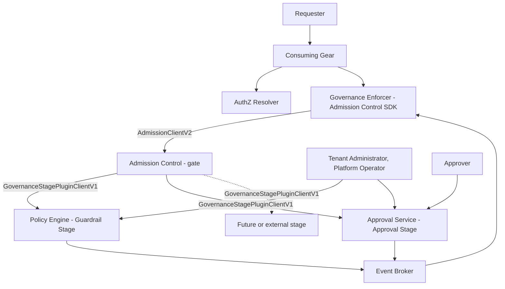
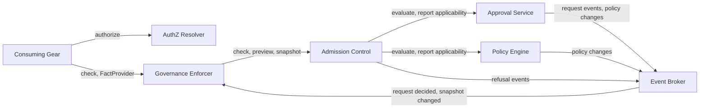
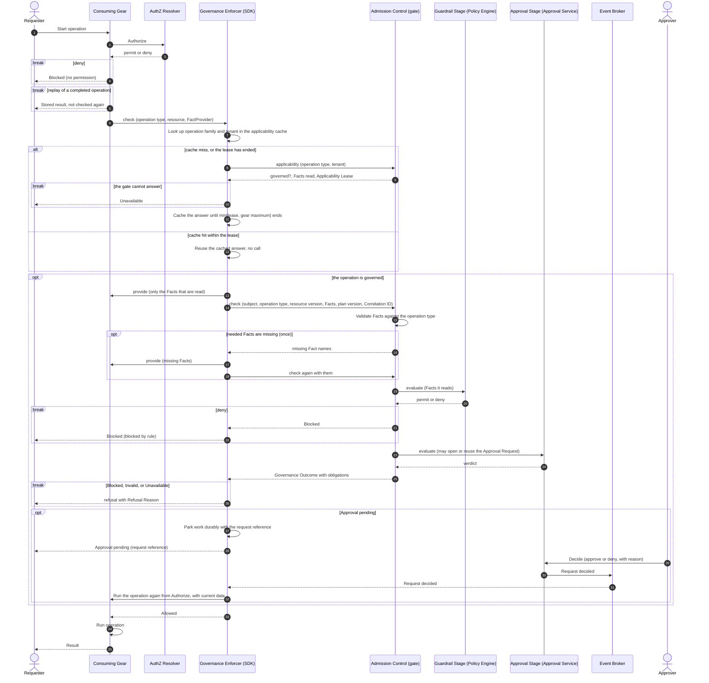
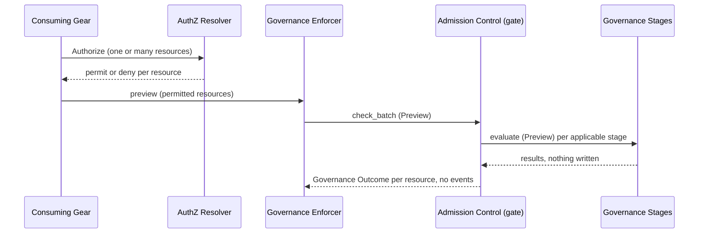

# Technical Design — Operation Governance


<!-- toc -->

- [1. Architecture Overview](#1-architecture-overview)
  - [1.1 Architectural Vision](#11-architectural-vision)
  - [1.2 Architecture Drivers](#12-architecture-drivers)
  - [1.3 Architecture Layers](#13-architecture-layers)
- [2. Principles & Constraints](#2-principles--constraints)
  - [2.1 Design Principles](#21-design-principles)
  - [2.2 Constraints](#22-constraints)
- [3. Technical Architecture](#3-technical-architecture)
  - [3.1 Domain Model](#31-domain-model)
  - [3.2 Component Model](#32-component-model)
  - [3.3 API Contracts](#33-api-contracts)
  - [3.4 Internal Dependencies](#34-internal-dependencies)
  - [3.5 External Dependencies](#35-external-dependencies)
  - [3.6 Interactions & Sequences](#36-interactions--sequences)
  - [3.7 Database schemas & tables](#37-database-schemas--tables)
  - [3.8 Deployment Topology](#38-deployment-topology)
- [4. Additional context](#4-additional-context)
- [5. Traceability](#5-traceability)

<!-- /toc -->

- [ ] `p1` - **ID**: `cpt-cf-operation-governance-design-operation-governance`

Terms and actors are defined in the [PRD](./PRD.md#14-glossary).

## 1. Architecture Overview

### 1.1 Architectural Vision

Operation Governance uses the **policy enforcement point / policy decision point (PEP/PDP)** model of [NIST SP 800-162](https://csrc.nist.gov/pubs/sp/800/162/upd2/final), already used for [Authorization](../authorization/DESIGN.md#pdppep-model):

| Role | Component | Responsibility |
|---|---|---|
| Access decision point | AuthZ Resolver | Authorization, called by the Consuming Gear before governance |
| Enforcement point | Governance Enforcer (Admission Control SDK), inside each Consuming Gear | Fast path, Fact loading, one Governance Check, outcome mapping, parking, checking again |
| Governance decision point | Admission Control, the governance gate | Validates Facts, resolves the Governance Profile, runs Governance Stages in order, combines one Governance Outcome |
| Governance Stages | Policy Engine (Guardrail Stage), Approval Service (Approval Stage), future stages | Evaluate one kind of Policy each |

The gate works like the Kubernetes API server's admission chain and Envoy's external authorization filter. Stages run in a fixed order, and the first refusal decides (XACML deny-overrides). Side-effect-free stages run first. The Approval Stage, which can open an Approval Request, runs last, so Approvers are asked only about operations that can run. Approval is asynchronous: the Consuming Gear parks the work and checks again at the time of use. The gate API follows the request shape of the [OpenID AuthZEN Authorization API](https://openid.net/specs/authorization-api-1_0.html), with approval results returned as obligations.

Every authenticated operation is governable, but an operation that no Policy governs pays only an in-memory lookup. Each Governed Operation is an explicit GTS type, independent of the gear's API, so an API change never changes what Policies see. Facts that cost I/O are loaded only when an applicable Policy reads them. [ADR 0001](./ADR/0001-cpt-cf-operation-governance-adr-governance-gate.md) records the gate decision and [ADR 0002](./ADR/0002-cpt-cf-operation-governance-adr-fact-collection.md) the operation and Fact decision.

### 1.2 Architecture Drivers

#### Functional Drivers

| Requirement | Design Response |
|---|---|
| `cpt-cf-operation-governance-fr-operation-coverage` | A mandatory governance step on every route names the Governed Operation type or excludes the route with a reason; the conformance kit checks that every governed route makes one Governance Check ([§3.2](#32-component-model)). |
| `cpt-cf-operation-governance-fr-governed-operation` | An explicit GTS type per operation, derived from the Admission Control SDK base, with Facts and per-Fact traits, versioned apart from the API ([§3.1](#31-domain-model)); Approval Service extends it. |
| `cpt-cf-operation-governance-fr-fact-loading` | Stages compute exact reads sets when a Policy is published; the Applicability Snapshot carries them; the `FactProvider` loads only those Facts; the gate asks once for missing Facts. |
| `cpt-cf-operation-governance-fr-governance-profile` | The gate resolves the Governance Profile from the operation type and Product configuration. |
| `cpt-cf-operation-governance-fr-check-order` | The domain service checks after Authorization and idempotency replay; the gate runs stages in declared order and stops at the first refusal. |
| `cpt-cf-operation-governance-fr-governance-outcome`, `cpt-cf-operation-governance-fr-refusal-reasons` | The gate maps stage results to one outcome ([§3.1](#31-domain-model)). |
| `cpt-cf-operation-governance-fr-safe-retries` | Replays of completed operations are not checked again; retries of refused or pending attempts are. Only the Approval Stage writes, and it reuses the open request for the same Resource Version and approval binding. |
| `cpt-cf-operation-governance-fr-recheck`, `cpt-cf-operation-governance-fr-wait` | The Governance Enforcer parks work durably; on a Decision event or an ended Approval Lease the gear runs the operation again from Authorization. |
| `cpt-cf-operation-governance-fr-plan` | The Governance Enforcer gets an outcome for every operation of a Plan before the gear applies any. |
| `cpt-cf-operation-governance-fr-preview` | The gate runs stages in Preview mode; batch form for many resources. |
| `cpt-cf-operation-governance-fr-policy-kinds`, `cpt-cf-operation-governance-fr-policy-layers`, `cpt-cf-operation-governance-fr-self-managed`, `cpt-cf-operation-governance-fr-policy-lifecycle`, `cpt-cf-operation-governance-fr-change-effect`, `cpt-cf-operation-governance-fr-trial-mode` | Each stage owns its Policies and applies the same layering; changes reach Governance Enforcers through the Applicability Snapshot. |
| `cpt-cf-operation-governance-fr-approval-requests`, `cpt-cf-operation-governance-fr-decisions`, `cpt-cf-operation-governance-fr-approval-binding`, `cpt-cf-operation-governance-fr-standing-approvals` | Approval Service, as the Approval Stage. |
| `cpt-cf-operation-governance-fr-explainable-outcome`, `cpt-cf-operation-governance-fr-audit-trail` | The gate returns what produced the outcome, with the plan version; one Correlation ID crosses every stage and resumed attempt. |

#### NFR Allocation

| NFR ID | NFR Summary | Allocated To | Design Response | Verification Approach |
|---|---|---|---|---|
| `cpt-cf-operation-governance-nfr-fail-closed` | No Allowed on failure | Governance Enforcer, gate, every stage | Any error, timeout, missing stage, stale snapshot, or Fact still missing after one request gives a full check or Unavailable; an operation whose Governance Profile names a stage that is not deployed is always marked governed in the snapshot | Fault injection per stage, snapshot state, and Fact |
| `cpt-cf-operation-governance-nfr-zero-policy-overhead` | No I/O without Policies | Governance Enforcer | In-memory Applicability Snapshot lookup | Benchmark in the Consuming Gear |
| `cpt-cf-operation-governance-nfr-latency` | At most two calls per attempt, bounded | Governance Enforcer, gate | One `AdmissionClientV2::check` call; a second only when the gate asks for missing Facts; stage bounds; contract-binding transport | Benchmark per deployment profile; alert on the rate of missing-Facts answers |
| `cpt-cf-operation-governance-nfr-revocation-delay` | Approval Lease and Policy Propagation Delay | Governance Enforcer, gate, Approval Stage | Allowed results cached only until their Approval Lease ends; an applicability answer is reused only for its Applicability Lease, capped by the gear's maximum and never longer than the Policy Propagation Delay; change notices end a lease early | Revoke and publish end-to-end with a controlled clock |
| `cpt-cf-operation-governance-nfr-tenant-isolation` | No reads across tenants | Stages, gate | Stages resolve tenants through Tenant Resolver and respect barriers; snapshot entries are served per tenant scope, on demand | Authorization test matrix |
| `cpt-cf-operation-governance-nfr-sensitive-facts` | No Fact values in logs, traces, events | Every component | Events, spans, and decision records carry Fact names and the approval binding digest only; `sensitive` Facts never reach an external stage that is not allowed them; Approvers see only `approver_visible` Facts | Log, trace, and event scans |

#### Key ADRs

| ADR ID | Decision Summary |
|---|---|
| `cpt-cf-operation-governance-adr-governance-gate` | Admission Control is the governance gate: one AuthZEN-shaped decision API over ordered Governance Stage plugins. |
| `cpt-cf-operation-governance-adr-fact-collection` | Explicit Governed Operation types, independent of the API and checked in the domain service; a mandatory route step for coverage; an Applicability Snapshot for the fast path; Facts loaded only when read, with one missing-Facts fallback. |

### 1.3 Architecture Layers



- [ ] `p3` - **ID**: `cpt-cf-operation-governance-tech-layers`

| Layer | Responsibility | Technology |
|---|---|---|
| Enforcement | Fast path, Facts, one Governance Check, outcome mapping, parking, checking again | Governance Enforcer and `FactProvider` in the Admission Control SDK; governance step in `OperationBuilder` and contract macros; durable execution |
| Decision | Validate Facts, order stages, combine the outcome, Preview, snapshot | Admission Control `AdmissionClientV2` (REST and gRPC projections) |
| Stages | Evaluate one kind of Policy each | `GovernanceStagePluginClientV1` plugins discovered through Types Registry |
| Administration | Policies, Decisions, and audit | Policy Engine and Approval Service REST APIs |
| Platform | Tenants, types, groups, events, transport, rule evaluation | Tenant Resolver, Types Registry, Resource Group, Event Broker, ToolKit contract binding, `toolkit-policy-evaluation` |

## 2. Principles & Constraints

### 2.1 Design Principles

#### Ordered Stages, Deny Overrides

- [ ] `p1` - **ID**: `cpt-cf-operation-governance-principle-ordered-stages`

One gate runs the applicable Governance Stages in a fixed order and stops at the first refusal. A refusal from any stage wins over any allow, including an earlier approval.

**ADRs**: `cpt-cf-operation-governance-adr-governance-gate`

#### Check Before Asking

- [ ] `p1` - **ID**: `cpt-cf-operation-governance-principle-check-before-asking`

Stages without side effects run first. The Approval Stage, which can open an Approval Request, runs last.

**ADRs**: `cpt-cf-operation-governance-adr-governance-gate`

#### Pay Only for What Is Governed

- [ ] `p1` - **ID**: `cpt-cf-operation-governance-principle-pay-for-governed`

An operation that no Policy governs costs one in-memory lookup. A governed operation loads only the Facts its applicable Policies read.

**ADRs**: `cpt-cf-operation-governance-adr-fact-collection`

#### Governance Contract Apart from the API

- [ ] `p1` - **ID**: `cpt-cf-operation-governance-principle-contract-apart-from-api`

A Governed Operation and its Facts are a contract for Policy authors, declared as their own GTS type. Routes, API versions, and DTOs never define them, so an API change breaks the gear's build, never a Policy.

**ADRs**: `cpt-cf-operation-governance-adr-fact-collection`

#### Check at Time of Use

- [ ] `p1` - **ID**: `cpt-cf-operation-governance-principle-time-of-use`

A result is valid only for the moment it was produced, or until its Approval Lease ends. Work that waited runs the whole sequence again before it runs.

**ADRs**: `cpt-cf-operation-governance-adr-governance-gate`

#### Fail Closed

- [ ] `p1` - **ID**: `cpt-cf-operation-governance-principle-fail-closed`

A check that cannot answer is a refusal. A missing stage, a timeout, an unexpected error, a stale snapshot, or a missing Fact never skips a check.

**ADRs**: `cpt-cf-operation-governance-adr-governance-gate`, `cpt-cf-operation-governance-adr-fact-collection`

### 2.2 Constraints

#### Trusted and Consistent Inputs

- [ ] `p1` - **ID**: `cpt-cf-operation-governance-constraint-trusted-inputs`

The subject and the Envelope Facts always come from the security context, never from the request body. The gate resolves the Governance Profile from the operation type and Product configuration. Other Facts are asserted by the Consuming Gear: the gate checks that the calling gear owns the operation type and that every Fact is declared and matches its schema, but not that it is true. Every check carries the calling gear's service identity, on remote hops and on in-process ClientHub calls alike; a check without it is Invalid. Every stage of one Governance Check sees the same inputs and Correlation ID.

**ADRs**: `cpt-cf-operation-governance-adr-governance-gate`, `cpt-cf-operation-governance-adr-fact-collection`

#### Facts Are Values at Check Time

- [ ] `p1` - **ID**: `cpt-cf-operation-governance-constraint-point-in-time-facts`

A Fact is read before the operation's write and is not locked. Concurrent operations can each pass a check on the same count. Limits and counters belong to Quota Enforcement, not to Policies.

**ADRs**: `cpt-cf-operation-governance-adr-fact-collection`

#### Tenant Plane Only

- [ ] `p1` - **ID**: `cpt-cf-operation-governance-constraint-tenant-plane`

Governed Operations are calls on the tenant plane (`SecurityContext`). Calls on the platform plane (`PlatformSecurityContext`) are not governed, following the [two-plane model](../toolkit-oop/ADR/0008-cpt-cf-adr-two-plane-auth.md).

**ADRs**: `cpt-cf-operation-governance-adr-fact-collection`

#### Platform Contracts

- [ ] `p1` - **ID**: `cpt-cf-operation-governance-constraint-platform-contracts`

`AdmissionClientV2` and `GovernanceStagePluginClientV1` are remote-capable contracts of [ToolKit contract binding](../toolkit-contract-binding/DESIGN.md), versioned per its [versioning ADR](../toolkit-contract-binding/ADR/0007-cpt-cf-binding-adr-contract-versioning.md), with errors in the [canonical error](../errors/PRD.md) format. Governed Operation types are versioned in Types Registry, apart from the gear's API. There is no shared governance database.

**ADRs**: `cpt-cf-operation-governance-adr-governance-gate`, `cpt-cf-operation-governance-adr-fact-collection`

## 3. Technical Architecture

### 3.1 Domain Model

**Technology**: Rust types in the Admission Control SDK and ToolKit; GTS types in Types Registry.

- [ ] `p2` - **ID**: `cpt-cf-operation-governance-entity-governance-model`

| Entity | Description | Owner |
|---|---|---|
| Governed Operation type | GTS type derived from `gts.cf.core.admission_control.governed_operation.v1~`, named by resource type and action. Its `facts` schema declares the Facts; its traits give per-Fact metadata and `replaces` | Base: Admission Control SDK. Derived type: the Consuming Gear. An Approval Service opportunity refers to it, takes its Facts from it, and adds the approval settings: Operation Default, Standing Approval setting, decision authority, accepted projection and subject types |
| Governance Stage registration | GTS plugin instance: stage kind, order, side effects, Preview support | Each stage |
| Applicability Snapshot | Versioned, signed map: Governed Operation family × tenant scope → applies or not, the Facts read, the Applicability Lease, and (p2) local rules | Built by the gate from stage reports; each answer cached by the Governance Enforcer for its lease |
| Governance Check request | Subject from the security context (ID, kind — user or API client — and tenant), action (operation type), resource (type, ID, tenant, Resource Version), context (Facts, and Facts the gear could not load), mode, plan version, round, Correlation ID | Governance Enforcer |
| Governance Check result | Governance Outcome, Refusal Reason, what produced it, plan version, obligations (Approval Request reference, unmet requirements, check-again time); or the names of missing Facts | Gate |
| Guardrail Policy | Versioned deny rule with a Policy Scope and its reads set | Policy Engine |
| Approval Rule, Approval Policy, Auto-Approval Rule, Approval Request, Decision | Approval governance and state | Approval Service |
| Parked work | The operation, its Correlation ID, and its Approval Request reference, waiting durably | Consuming Gear, through durable execution |

**The Facts contract.** A Fact ID is a top-level property of `facts`; nested fields load with their parent. Per-Fact traits:

| Trait | Meaning | Default |
|---|---|---|
| `tier` | `request`, `computed`, or `costly` | `request` |
| `sensitive` | Never sent to an external stage unless that stage is allowed it | `false` |
| `approver_visible` | Shown to Approvers, and loaded when approval may be required | `false` |
| `binding` | Part of the approval binding; volatile Facts, such as counts, are not | `true` |
| `replaces` | Operation-level: Fact IDs of the previous version renamed in this one | none |

```rust
#[gts_type_schema(
    dir_path = "schemas",
    base = GovernedOperationV1,
    type_id = gts_id!("cf.core.og.governed_operation.v1~cf.file_storage.create_file.v1~"),
    properties = "gts_file_type,mime_type,max_bytes,owner_file_count",
    traits = CreateFileV1::og_traits()          // generated from the #[fact] attributes
)]
#[derive(Default, GovernedFacts)]
pub struct CreateFileV1 {
    #[fact(request)]                                    gts_file_type: String,
    #[fact(request)]                                    mime_type: String,
    #[fact(computed)]                                   max_bytes: Option<u64>,
    #[fact(costly, approver_visible, binding = false)]  owner_file_count: u64,
}
```

**One declaration per Fact.** `#[derive(GovernedFacts)]` (Operation Governance SDK) generates from the `#[fact]` attributes: the traits, a typed provider trait with one method per Fact, the `FactProvider` dispatch, and a test that the GTS schema carries exactly these Facts and traits. The method shape follows the tier, so the compiler enforces what a tier means:

| Tier | Generated method | Enforced |
|---|---|---|
| `request`, `computed` | `fn fact(input: &Self::Input) -> FactValue<T>` | Synchronous, so no `.await`; no `&self`, so a repository or connection the provider holds is out of reach |
| `costly` | `async fn fact(&self) -> FactValue<T>` | May do I/O; `LazySource` loads a shared source (such as one row) at most once per check |

A missing, misspelled, or mistyped Fact, a Fact without a tier, and a `replaces` entry naming a field that does not exist are compile errors.

Policies read Facts by Fact ID: `facts.<id>` in CEL, and `input.properties.<id>` in Policy Engine's Rego. Policies refer to the operation family: the type ID without its version. Adding an optional Fact is compatible. Renaming, retyping, or removing one needs a new type version; Types Registry refuses a breaking change in place. The new version lists renamed Facts in its `replaces` trait (old ID → new ID). The Governance Enforcer asks the gear only for current IDs, the gate passes such a Fact under both IDs, and every stage matches Policies by family, never by exact version. A Policy that reads a removed or retyped Fact is reported when the version is registered; where it applies, checks give Unavailable until it is fixed. Whether a Fact is required is decided by the reads sets of applicable Policies, not by the schema.

**Policy Scope.** Every Policy of every stage has the same scope model:

| Scope | Set by | Applies to | Matched |
|---|---|---|---|
| Global | Platform Operator, in Product configuration | Every tenant, Self-Managed Tenants included | — |
| Tenant | Tenant Administrator | The tenant and its Managed descendants | By tenant layering and barriers |
| Actors (narrows either) | Whoever sets the Policy | Named users, named API clients, or groups | In the Governance Check, on the subject from the security context; groups through Resource Group |

Applicability stays per operation family and tenant: an actor-scoped Policy makes the operation governed for its whole tenant scope, and the actor match is made in the Governance Check. So the Governance Enforcer's cache holds one answer per tenant, not one per actor, and a Requester outside the actors gets Allowed from the check, not from the cache.

**Operation patterns (p3).** A Policy may name a GTS pattern of operation families instead of one family. The stage expands the pattern against Types Registry when the Policy is published and checks that every Fact the Policy reads is declared, with the same schema, by every matching operation; a Policy that reads only Envelope Facts matches any operation. Applicability is still answered per operation family: the pattern's Policy is part of the answer for each family it matches. When a new operation type is registered, the stage re-checks the pattern Policies that match it; one that reads an undeclared Fact makes checks where it applies Unavailable and is reported to its Tenant Administrator.

**Asynchronous checks (p3).** A Policy may be marked asynchronous. It is not part of the Governance Check and never delays or refuses the operation. After the operation ran, the Governance Enforcer publishes the check request it already built (operation, subject, resource, Facts, Correlation ID) as an event; a stage evaluates its asynchronous Policies on those Facts, records the result, and publishes it as a finding event that tenants, Auditors, or the Consuming Gear consume. Applicability reports asynchronous Policies apart, so an operation governed only by them still takes the fast path and only publishes the event.

**How results map to the Governance Outcome** (in the gate)

| Source | Result | Governance Outcome | Refusal Reason |
|---|---|---|---|
| Gate | Unknown operation type, caller does not own it, or undeclared, malformed, or too-large Facts | Invalid | invalid Facts |
| Gate | A needed Fact is still missing after one request for it, or the gear reports it unavailable | Unavailable | unavailable |
| Gate | A stage in the Governance Profile is not deployed, fails, or times out | Unavailable | unavailable |
| Guardrail Stage | deny | Blocked | blocked by rule |
| Approval Stage | `denied` by a rule | Blocked | blocked by rule |
| Approval Stage | `denied` by a Decision | Blocked | denied by Approver |
| Approval Stage | `approval_required` (Preview) | Approval required | approval missing |
| Approval Stage | `pending` | Approval pending | approval missing |
| Approval Stage | `invalid` | Invalid | invalid Facts |
| All applicable stages | permit, `not_required`, `approved` | Allowed | — |

The Consuming Gear reports an Authorization deny as Blocked (no permission). The Governance Enforcer maps outcomes to the [canonical error categories](../errors/PRD.md): Blocked as `permission_denied`, Invalid as `invalid_argument`, Unavailable as `service_unavailable` with a retry hint, and Approval required as `failed_precondition`. Approval pending is a successful "accepted" response with the request reference when the operation can wait, or `failed_precondition` with the request reference when it cannot. The Requester sees the message the Policy author wrote, never the rule body or Fact values.

### 3.2 Component Model



#### Governance Enforcer

- [ ] `p1` - **ID**: `cpt-cf-operation-governance-component-enforcer`

**Why it exists:** Every Consuming Gear must enforce governance the same way, with no per-gear composition code.

**Owns:** The applicability cache, keyed by operation family and tenant: an answer fetched on a miss and reused until its Applicability Lease ends; calling the gear's `FactProvider` for only the Facts that are read, one call per Fact Tier; one Governance Check per attempt, plus one more when the gate asks for missing Facts; (p2) local CEL rules within a cost bound; outcome mapping to canonical errors; durable parking; starting the operation again on a Decision event or an ended Approval Lease; Plans; counting governed requests that completed without a check.

**Does not own:** Authorization or idempotency replay, which the gear runs first; Policies, approval state, or the order of stages.

**How a gear uses it:** the route declares `governed::<Op>()` or `not_governed(reason)` in `OperationBuilder`. The domain service calls the Governance Enforcer after Authorization and idempotency replay, and before the first side effect, with a `FactProvider` that fills Facts from domain types through a typed Fact API generated from the operation type. The SDK conformance kit (fake gate, plan builder, `FactProvider` checker) runs in the gear's tests; it fails a governed route that reaches a side effect without a check for each governed operation it performs.

**Related components:** calls `cpt-cf-operation-governance-component-gate`; subscribes to events of `cpt-cf-operation-governance-component-approval-stage`.

#### Governance Gate (Admission Control)

- [ ] `p1` - **ID**: `cpt-cf-operation-governance-component-gate`

**Why it exists:** One place validates, orders, combines, and explains every Governance Check, and lets new stages plug in.

**Owns:** `AdmissionClientV2`; validation of every check against its operation type; the set of needed Facts from its own current plan, and the request for missing ones; Governance Profile resolution; stage discovery through Types Registry; ordered stage execution with deny-overrides and fail-closed bounds; giving an external stage only the Facts it reads; outcome mapping; Preview mode without events; merging stage reports into the signed Applicability Snapshot; refusal events. See the [Admission Control design](../../../gears/system/admission-control/docs/DESIGN.md).

**Does not own:** Policy storage, approval state, or running the operation. It is stateless.

**Related components:** called by `cpt-cf-operation-governance-component-enforcer`; calls `cpt-cf-operation-governance-component-guardrail-stage` and `cpt-cf-operation-governance-component-approval-stage`.

#### Guardrail Stage (Policy Engine)

- [ ] `p1` - **ID**: `cpt-cf-operation-governance-component-guardrail-stage`

**Why it exists:** Guardrail Policies need versioning, tenant assignment, and sandboxed evaluation.

**Owns:** Guardrail Policies, Platform Rules as built-in policies, Policy Scopes (global, tenant with layering and barriers, actors), Trial Mode, applicability, and reads sets computed at publish time. It refuses a Policy that reads an undeclared Fact, and a Tenant Rule whose Rego references are not exact; an inexact Platform Rule counts as reading every declared Fact. See the [Policy Engine design](../../../gears/system/policy-engine/docs/DESIGN.md).

**Does not own:** Approval state. It has no side effects during a check.

**Related components:** called by `cpt-cf-operation-governance-component-gate`.

#### Approval Stage (Approval Service)

- [ ] `p1` - **ID**: `cpt-cf-operation-governance-component-approval-stage`

**Why it exists:** Approval state outlives a single call.

**Owns:** Approval Rules, Approval Policies, and Auto-Approval Rules with their Policy Scopes; Approval Requests, Decisions, Standing Approvals, request events, audit, applicability, and exact reads sets of its conditions. Approvals bind to a SHA-256 digest of the operation family and the values of the `binding` Facts that its own rules read, plus its approver-visible `binding` Facts; Facts that only other stages read never change it. Approvers see only `approver_visible` Facts that their own authorization allows. It builds each verification from the Governance Check alone: the opportunity registered for the operation family (none gives `not_required`), and the projection type mapped from the check's resource type. See the [Approval Service design](../../../gears/approval-service/docs/DESIGN.md).

**Does not own:** Running, parking, or waiting for the operation. It never calls the gate.

**Related components:** called by `cpt-cf-operation-governance-component-gate`; publishes events to `cpt-cf-operation-governance-component-enforcer`.

**Where to write a block.** Both stages can block, and any block wins. Write a block as a Guardrail Policy when it must apply without Approval Service or to operations without the Approval Stage. Write it as an Approval Rule when it is one band of an approval decision on the same Facts, such as "10,000 or more is blocked, 1,000–9,999 needs approval". The outcome names the stage and the Policy either way.

### 3.3 API Contracts

- [ ] `p1` - **ID**: `cpt-cf-operation-governance-interface-governance-api`

| Contract | Kind | Operations | Defined in |
|---|---|---|---|
| `AdmissionClientV2` | Remote-capable API of Admission Control, REST and gRPC projections | `check` (enforce or Preview; returns an outcome or the missing Fact names), `check_batch` (Preview), `applicability` (the answer for one operation and tenant, with its Applicability Lease; or snapshot entries by tenant and version) | Admission Control SDK, new major ([ADR 0001](./ADR/0001-cpt-cf-operation-governance-adr-governance-gate.md)) |
| `GovernanceStagePluginClientV1` | Remote-capable plugin contract, REST and gRPC projections | `evaluate` (enforce or Preview), `applicability` | Admission Control SDK, new |
| `FactProvider` | Rust trait implemented by the Consuming Gear | `provide` (the Facts named, one Fact Tier per call) | Admission Control SDK, new ([ADR 0002](./ADR/0002-cpt-cf-operation-governance-adr-fact-collection.md)) |
| Authorization | AuthZ Resolver | access evaluation | [Authorization design](../authorization/DESIGN.md#api-specifications) |
| Approval Request read and events | Approval Service | read request by reference; decided and closed events | [Approval Service PRD §7](../../../gears/approval-service/docs/PRD.md#7-public-library-interfaces) |
| `AdmissionClientV1` | Kept during migration | `admit` | [Admission Control PRD §7](../../../gears/system/admission-control/docs/PRD.md#7-public-library-interfaces) |

### 3.4 Internal Dependencies

| Dependency Gear | Interface Used | Purpose |
|---|---|---|
| AuthZ Resolver | SDK client | Authorization |
| Admission Control | `AdmissionClientV2` | Governance Check, Preview, Applicability Snapshot |
| Approval Service | SDK client, events | Approval Request read and events for parked work |
| Event Broker | Subscription | Decision events and snapshot change notices |
| Types Registry | GTS | Governed Operation types and stage discovery |

Policy Engine, Tenant Resolver, and Resource Group are dependencies of the stages, not of the Consuming Gear. The security context is propagated on every call.

### 3.5 External Dependencies

None in the base design. (p3) An external decision engine (for example OPA or Cedar), a webhook, or a Serverless Runtime function can be added as a Governance Stage. The Platform Operator registers it with: the operation types it covers, a CEL match condition, the Facts it reads (a subset of each type's Facts), the `sensitive` Facts it is allowed, a target reached through OAGW or Serverless Runtime, a timeout, and a failure policy. The gate sends it only the Facts it reads and validates its answer. It may ask for missing Facts within the same one-request limit; asking for a Fact outside its reads gives Unavailable.

### 3.6 Interactions & Sequences

#### Check, Wait, and Run a Governed Operation

**ID**: `cpt-cf-operation-governance-seq-check-and-execute`

**Use cases**: [OG-UC-02](./USECASES.md#og-uc-02-check-an-operation-before-performing-it--p1), [OG-UC-04](./USECASES.md#og-uc-04-wait-for-an-approval-outcome--p1), [OG-UC-15](./USECASES.md#og-uc-15-ask-for-approval-and-track-it--p1), [OG-UC-16](./USECASES.md#og-uc-16-review-and-decide-on-requests--p1)

**Actors**: `cpt-cf-operation-governance-actor-requester`, `cpt-cf-operation-governance-actor-consuming-gear`, `cpt-cf-operation-governance-actor-authz-resolver`, `cpt-cf-operation-governance-actor-approver`, `cpt-cf-operation-governance-actor-event-broker`



**Description**: The Consuming Gear authorizes first and returns the stored result of a replayed operation that completed, without a new check; a retry of a refused or pending attempt is checked again. Then the Governance Enforcer looks up the operation family and tenant in its applicability cache. On a miss, or when the cached answer's Applicability Lease has ended, it asks the gate once and caches the answer for the lease the gate grants, capped by the gear's configured maximum; a lease of zero is not cached. Within the lease every check reuses the answer with no call, which is the fast path. When nothing applies, the operation runs with no further governance work. Otherwise it loads only the Facts that applicable Policies read and makes one Governance Check. If the gate's current plan needs Facts that were not sent, for example after a Policy change inside the lease, the gate names them, the Governance Enforcer drops the cached answer, and sends them once; a second miss gives Unavailable. The gate runs the Guardrail Stage, then the Approval Stage, and stops at the first refusal. With an Approval Request open, the work is parked durably. When a Decision event arrives, or the gear's own wait ends, the whole sequence runs again with current data, so a deny Decision or a new block now gives Blocked. For a Plan, the Governance Enforcer gets an outcome for every operation before the gear applies any.

#### Preview a Governed Operation

**ID**: `cpt-cf-operation-governance-seq-preview`

**Use cases**: [OG-UC-03](./USECASES.md#og-uc-03-preview-a-result-without-effects--p1)

**Actors**: `cpt-cf-operation-governance-actor-consuming-gear`, `cpt-cf-operation-governance-actor-authz-resolver`



**Description**: The same order without side effects. The Approval Stage returns Approval required instead of opening a request, and the gate publishes no refusal events.

#### Policy Change Reaches the Governance Enforcer

**ID**: `cpt-cf-operation-governance-seq-snapshot-refresh`

**Use cases**: [OG-UC-07](./USECASES.md#og-uc-07-change-a-live-policy--p1), [OG-UC-01](./USECASES.md#og-uc-01-declare-a-governed-operation--p1)

**Actors**: `cpt-cf-operation-governance-actor-tenant-admin`, `cpt-cf-operation-governance-actor-event-broker`

```mermaid
sequenceDiagram
    actor T as Tenant Administrator
    participant S as Governance Stage
    participant EB as Event Broker
    participant GE as Governance Enforcer
    participant AC as Admission Control (gate)
    T->>S: Publish Policy
    S->>S: Compute reads set; refuse undeclared Facts
    S->>EB: Policy changed (tenant scope, new version)
    EB-->>GE: Snapshot changed (ends the lease of cached answers in that tenant scope)
    GE->>AC: applicability (tenant, since version)
    AC->>S: applicability
    S-->>AC: applies, Facts read
    AC-->>GE: Signed delta, new version, Applicability Lease
```

**Description**: A Policy change reaches every Governance Enforcer within the Policy Propagation Delay. The Governance Enforcer refreshes only tenant entries it holds, with a random delay to spread load, and accepts only signed entries with a higher version. A lost notice is covered by the Applicability Lease: every cached answer expires when its lease ends, so the next check fetches a fresh one. The Policy Propagation Delay is therefore at most the lease plus one fetch.

### 3.7 Database schemas & tables

There is no shared database. Each stage owns its storage. The gate is stateless. Parked work is stored by the Consuming Gear through durable execution. Records are linked by Correlation ID, Approval Request reference, and Policy version.

### 3.8 Deployment Topology

- [ ] `p2` - **ID**: `cpt-cf-operation-governance-topology-profiles`

| ToolKit profile | Governance Enforcer | Admission Control and Guardrail Stage | Approval Stage |
|---|---|---|---|
| Embedded | In each gear | In the same process, called in-process through ClientHub | In the same process |
| Self-Hosted | In each gear | One out-of-process "governance plane" unit, like the AuthZ plane; scaled out | Its own unit, called by the gate over REST or gRPC |
| Kubernetes Native | In each gear | A stateless deployment, horizontally scaled | Its own deployment |

The Guardrail Stage stays in the same unit as the gate, so Policy Engine's database is reached only by its own gear. Consuming Gears never link Policy Engine.

## 4. Additional context

**Fit with the ToolKit out-of-process and contract-binding model.** The current ToolKit supports most of this design:

- Remote-capable contracts with generated REST and gRPC clients ([contract binding](../toolkit-contract-binding/DESIGN.md)).
- Security context propagation with re-validation on each hop ([two-plane auth](../toolkit-oop/ADR/0008-cpt-cf-adr-two-plane-auth.md)).
- Plugin discovery through Types Registry and remote plugin transport ([OoP design](../toolkit-oop/DESIGN.md)).
- GTS base and derived types with traits, as used by License Resolver.
- Sandboxed Rego with a cost bound and input-reference analysis (`toolkit-policy-evaluation`).
- Trace context propagation for linking spans.
- Durable execution for parked work.

**Required changes.** These changes are required:

| Area | Change | Why |
|---|---|---|
| Admission Control | New `AdmissionClientV2` and `GovernanceStagePluginClientV1` contracts with REST and gRPC projections; ordered stages instead of one engine; Preview mode; caller Correlation ID; Governance Profile resolution; Fact validation against operation types; the missing-Facts answer; signed snapshot merging | Today it is in-process only, with one engine and an admit-or-refuse result; in Kubernetes Native each gear would otherwise have to link Policy Engine and reach its database |
| Admission Control SDK | Governed Operation base type and traits, including `replaces`; Governance Enforcer; `FactProvider` and the typed Fact API generated from operation types; conformance kit in `test_support` | Same enforcement in every gear, with Facts checked at compile time |
| Policy Engine | Implement `GovernanceStagePluginClientV1`; compute reads sets at publish time; refuse undeclared Facts and inexact Tenant Rules; publish change events | Today it implements the single-engine plugin contract only |
| Approval Service | Implement `GovernanceStagePluginClientV1`; report applicability and reads sets; approval opportunity refers to one Governed Operation type and takes its Facts from it; bind approvals to the digest of the `binding` Facts its own rules read | Today gears call verification directly and opportunities are defined only here |
| ToolKit `OperationBuilder` and contract macros | Mandatory governance step (`governed::<Op>()` or `not_governed(reason)`), like the license step | Coverage of every operation (ADR 0002) |
| ToolKit ClientHub | The calling gear's service identity on every in-process call, as remote hops already carry it | The gate refuses a check for another gear's operation (ADR 0002) |
| `toolkit-policy-evaluation` | A CEL backend, lifted from Quota Enforcement's bounded CEL profile, with cost estimation; a flag saying whether a document's input references are exact | Exact reads sets; one evaluator for stages and (p2) local rules |
| ToolKit durable execution | A step that waits for an external event (an Approval Request decided) with a timeout | Today it has no wait for outside events; parked work must survive restarts |
| ToolKit contract binding | Circuit breaking for sustained unavailability of a remote stage, treated as Unavailable | Listed as open in contract binding |
| Correlation | The Correlation ID is the platform request ID (`x-request-id`), carried with parked work; spans keep the W3C trace ID | Contract binding correlates by trace ID only; audit uses the request ID |

**Applicability Lease.** The gate grants a lease with every applicability answer, "not governed" included, because that answer is what lets ungoverned operations skip the gate. The Governance Enforcer caches the answer for the shorter of the lease and its own configured maximum.

| Setting | Where | Default | Meaning |
|---|---|---|---|
| `applicability_lease_ms` | Governance backend, for example `og-rego-config-plugin` | 30 000 (30 s); at most 600 000 | Lease granted with each answer; `0` turns caching off |
| `max_applicability_lease` | Governance Enforcer (`EnforcerConfig`), exposed by a gear as configuration | 60 s | Upper bound a gear accepts, whatever the backend grants |

A shorter lease applies Policy changes sooner and costs more applicability calls; the defaults keep one call per operation family and tenant every 30 seconds per gear instance. The Policy Propagation Delay a Product configures must be at least the lease.

**Latency budget.** In out-of-process profiles, a governed check adds two remote hops (Governance Enforcer to gate, gate to the Approval Stage), each within the contract-binding budget (5 ms p95 on one host, 10 ms in a cluster), plus one security context re-validation per hop. A missing-Facts answer adds one more Enforcer-to-gate hop and one Fact load; it should be rare, and its rate is monitored. The fast path adds none.

**Rollout.** p1: operation types, the route step, the remote check with Facts of every tier, reads sets for CEL and exact Rego, and the missing-Facts answer. p2: local CEL rules. p3: external stages, asynchronous checks, Policies on operation patterns.

**Confirmation per Consuming Gear.** Each Consuming Gear runs the SDK conformance kit and verifies the [PRD acceptance criteria](./PRD.md#9-acceptance-criteria) at its operation boundary, with fault injection for each stage, each snapshot state, and each Fact.

## 5. Traceability

- **PRD**: [PRD.md](./PRD.md)
- **ADRs**: [ADR/](./ADR/)
- **Use cases**: [USECASES.md](./USECASES.md)
- **Gear and platform designs**: [Admission Control](../../../gears/system/admission-control/docs/DESIGN.md), [Policy Engine](../../../gears/system/policy-engine/docs/DESIGN.md), [Approval Service](../../../gears/approval-service/docs/DESIGN.md), [Authorization](../authorization/DESIGN.md), [Canonical errors](../errors/DESIGN.md), [ToolKit out-of-process](../toolkit-oop/DESIGN.md), [ToolKit contract binding](../toolkit-contract-binding/DESIGN.md)
