# Technical Design — Approval Service

- [ ] `p1` - **ID**: `cpt-cf-approval-service-design-approval-service`

<!-- toc -->

- [1. Architecture Overview](#1-architecture-overview)
  - [1.1 Architectural Vision](#11-architectural-vision)
  - [1.2 Architecture Drivers](#12-architecture-drivers)
  - [1.3 Architecture Layers](#13-architecture-layers)
- [2. Principles & Constraints](#2-principles--constraints)
  - [2.1 Design Principles](#21-design-principles)
  - [2.2 Constraints](#22-constraints)
- [3. Technical Architecture](#3-technical-architecture)
  - [3.1 Domain Model](#31-domain-model)
  - [3.2 Component Model](#32-component-model)
  - [3.3 API Contracts](#33-api-contracts)
  - [3.4 Internal Dependencies](#34-internal-dependencies)
  - [3.5 External Dependencies](#35-external-dependencies)
  - [3.6 Interactions & Sequences](#36-interactions--sequences)
  - [3.7 Database schemas & tables](#37-database-schemas--tables)
  - [3.8 Deployment Topology](#38-deployment-topology)
- [4. Additional context](#4-additional-context)
  - [4.1 Configuration and Benchmark Profile](#41-configuration-and-benchmark-profile)
  - [4.2 Quality Attributes](#42-quality-attributes)
  - [4.3 Deviations, Assumptions, and PRD Notes](#43-deviations-assumptions-and-prd-notes)
  - [4.4 ADR Candidates](#44-adr-candidates)
- [5. Traceability](#5-traceability)

<!-- /toc -->

## 1. Architecture Overview

### 1.1 Architectural Vision

The gear implements the synchronous approval verdict service of [PRD §1.1](./PRD.md#11-purpose) and [PRD §3](./PRD.md#3-operational-concept--environment), within the scope of [PRD §4](./PRD.md#4-scope). It owns the governance data behind a verdict and never executes or waits for the protected operation. Core ideas:

- **GTS extension points**: gears derive opportunity and projection types from two base types; behaviour comes from traits (`cpt-cf-approval-service-design-gts-extension-points`).
- **Live verdict derivation**: rule layers, policies, auto-approval rules, and decisions are read at verification time by one algorithm (`cpt-cf-approval-service-component-verdict-engine`).
- **Single-transaction change with outbox events**: each change commits with its audit record, change sequence, and event records; delivery follows commit (`cpt-cf-approval-service-component-change-recorder`).
- **Approval Stage of the governance gate**: gears do not call verification directly; their Governance Enforcer calls `admission-control`, which calls this gear last, after the Guardrail Stage, and reads its applicability reports (`cpt-cf-approval-service-component-stage-adapter`, [Operation Governance DESIGN](../../../docs/arch/operation-governance/DESIGN.md)).

### 1.2 Architecture Drivers

#### Functional Drivers

| Requirement | Design Response |
|-------------|------------------|
| `cpt-cf-approval-service-fr-register-req-type` | Derived opportunity types with mandatory traits, first-claim ownership — `cpt-cf-approval-service-seq-type-registration` |
| `cpt-cf-approval-service-fr-resource-projection` | Closed projection base; rows keyed by identity; deregistration archives — `cpt-cf-approval-service-seq-deregister-withdraw` |
| `cpt-cf-approval-service-fr-subject` | Identifier-only value object — `cpt-cf-approval-service-entity-subject` |
| `cpt-cf-approval-service-fr-context-attributes` | Validated against the opportunity schema, stored on the request, fingerprinted — `cpt-cf-approval-service-seq-verify-register` |
| `cpt-cf-approval-service-fr-approval-rules` | Runtime rules with reason and ETag — `cpt-cf-approval-service-component-governance-service` |
| `cpt-cf-approval-service-fr-rule-layers` | Platform rules and ancestor restrictions first, then the subject tenant's rule, then ancestor allow, platform default, gear default; sources held separately — `cpt-cf-approval-service-component-verdict-engine` |
| `cpt-cf-approval-service-fr-approval-policies` | Live one-stage policies, AND over the ancestor path — `cpt-cf-approval-service-seq-multi-approver-policy` |
| `cpt-cf-approval-service-fr-group-approvers` | p2: group references resolved by `cpt-cf-approval-service-component-directory-adapter` — `cpt-cf-approval-service-seq-group-membership` |
| `cpt-cf-approval-service-fr-policy-snapshot` | p2: `apsv_request.policy_snapshot` used for the request's target — `cpt-cf-approval-service-component-request-service` |
| `cpt-cf-approval-service-fr-subject-type-selector` | p2: optional `subject_type_pattern`, ranked last — `cpt-cf-approval-service-component-verdict-engine` |
| `cpt-cf-approval-service-fr-auto-approval` | p2: CEL rules with `approve` or `block_descendants` effect — `cpt-cf-approval-service-seq-auto-approval` |
| `cpt-cf-approval-service-fr-conditional-policies` | p2: CEL condition on policies — `cpt-cf-approval-service-tech-cel-conditions` |
| `cpt-cf-approval-service-fr-staged-policies` | p2: ordered `stages` — `cpt-cf-approval-service-seq-staged-escalation` |
| `cpt-cf-approval-service-fr-create-request` | Register option opens a request guarded by unique `open_key` — `cpt-cf-approval-service-seq-verify-register` |
| `cpt-cf-approval-service-fr-request-reconciliation` | Own key in the decision transaction, the rest by leased jobs — `cpt-cf-approval-service-seq-governance-reconciliation` |
| `cpt-cf-approval-service-fr-submit-decision` | PDP `approve` plus authority, standing, and separation-of-duties checks — `cpt-cf-approval-service-seq-record-decision` |
| `cpt-cf-approval-service-fr-on-behalf-decision` | p2: `decide_on_behalf` plus the named user's `approve` — `cpt-cf-approval-service-seq-record-decision` |
| `cpt-cf-approval-service-fr-bulk-approve` | One all-or-nothing transaction, per-item audit and event — `cpt-cf-approval-service-seq-record-decision` |
| `cpt-cf-approval-service-fr-verify-approval` | Verdict type with outcome, reason, producer, lease, version — `cpt-cf-approval-service-seq-verify-read-only` |
| `cpt-cf-approval-service-fr-batch-verify` | Read-only batch sharing ancestry and snapshot — `cpt-cf-approval-service-seq-verify-read-only` |
| `cpt-cf-approval-service-fr-correlation` | Stored on the request, echoed in verdicts and request events — `cpt-cf-approval-service-interface-change-events` |
| `cpt-cf-approval-service-fr-approval-lease` | Computed by `cpt-cf-approval-service-component-verdict-engine`, returned to the gate as the check-again obligation, honoured by the Governance Enforcer and `cpt-cf-approval-service-component-sdk-client` |
| `cpt-cf-approval-service-fr-applicability` | `cpt-cf-approval-service-component-applicability`: report per opportunity and tenant scope, attributes read from parsed CEL conditions and approver-visible attributes |
| `cpt-cf-approval-service-fr-verdict-resolution` | PRD algorithm in `cpt-cf-approval-service-component-verdict-engine` |
| `cpt-cf-approval-service-fr-tenant-hierarchy` | Ancestor path from `cpt-cf-approval-service-component-directory-adapter` — `cpt-cf-approval-service-seq-hierarchy-resolution` |
| `cpt-cf-approval-service-fr-administration` | OData lists, `:explain`, approver inbox — `cpt-cf-approval-service-component-query-service` |
| `cpt-cf-approval-service-fr-validate-eligibility` | PEP per opportunity type — `cpt-cf-approval-service-component-access-guard`, `cpt-cf-approval-service-design-permissions` |
| `cpt-cf-approval-service-fr-audit-trail` | Append-only audit row in the change transaction — `cpt-cf-approval-service-component-change-recorder` |
| `cpt-cf-approval-service-fr-event-notifications` | Event Broker managed outbox — `cpt-cf-approval-service-interface-change-events` |
| `cpt-cf-approval-service-fr-request-escalation` | p2: `:escalate` — `cpt-cf-approval-service-seq-staged-escalation` |
| `cpt-cf-approval-service-fr-subject-groups` | p2: decisions on group subjects — `cpt-cf-approval-service-seq-group-membership` |
| `cpt-cf-approval-service-fr-decision-expiry` | p2: ignored at read time; transition by `cpt-cf-approval-service-component-reconciler` |
| `cpt-cf-approval-service-fr-access-review` | p2: access review report — `cpt-cf-approval-service-component-query-service` |
| `cpt-cf-approval-service-fr-recertification` | p3: campaigns and items — `cpt-cf-approval-service-entity-recertification-campaign` |
| `cpt-cf-approval-service-fr-delegable-rules` | p3: `overridable` runtime rules — `cpt-cf-approval-service-component-verdict-engine` |
| `cpt-cf-approval-service-fr-governance-versions` | p2: design pending (added for USECASES alignment): versioned runtime rules and policies with drafts, history, comparison, rollback; ETag rejects stale changes — `cpt-cf-approval-service-component-governance-service` |
| `cpt-cf-approval-service-fr-governance-trial` | p3: design pending: trial-mode rules and policies reported beside, never inside, the verdict; draft evaluation against sample facts — `cpt-cf-approval-service-component-verdict-engine` |
| `cpt-cf-approval-service-fr-approver-exclusions` | p2: design pending: policies exclude people named in declared context attributes; checked with separation of duties — `cpt-cf-approval-service-component-decision-service` |
| `cpt-cf-approval-service-fr-refusal-reasons` | p1: design pending: reason category, code and message on every non-proceeding verdict; rule messages; refusal logs without values — `cpt-cf-approval-service-component-verdict-engine` |
| `cpt-cf-approval-service-fr-tenant-barriers` | p1: design pending: tenant chain stops at self-managed barriers; platform rules, platform defaults and configuration policies apply everywhere — `cpt-cf-approval-service-component-verdict-engine` |

#### NFR Allocation

| NFR ID | NFR Summary | Allocated To | Design Response | Verification Approach |
|--------|-------------|--------------|-----------------|----------------------|
| `cpt-cf-approval-service-nfr-latency` | p95 ≤ 50 ms; cache hit without network | Verdict Engine, SDK Client | Per-tenant governance snapshot checked by one version read; indexed point reads | Benchmark profile (§4.1); `apsv_verify_duration_seconds` |
| `cpt-cf-approval-service-nfr-throughput` | 1,000 calls/s with 1,000,000 decisions | Verdict Engine, Change Recorder and Storage | At most four indexed point reads per uncached call; no write on read-only calls; portable indexes | Load test (§4.1) on each database |
| `cpt-cf-approval-service-nfr-revocation-delay` | Changes reach callers within the lease | Governance Enforcer (via lease obligation), SDK Client | Caches only `approved`/`not_required` until lease end; register and bypass calls skip the cache | SDK tests with a controlled clock; revoke end-to-end |
| `cpt-cf-approval-service-nfr-atomicity` | Change, audit, event record in one transaction | Change Recorder | One `SecureTx` writes rows, sequence, audit, outbox events, reconciliation jobs | Fault injection per step; broker outage test |
| `cpt-cf-approval-service-nfr-reconciliation-delay` | Settled requests closed within a bound | Reconciler | Jobs enqueued in the change transaction; leased paged workers on every replica; bound `reconciliation_bound_secs` | 10,000-request policy change; `apsv_reconciliation_lag_seconds` |
| `cpt-cf-approval-service-nfr-availability` | Fail closed | Verdict Engine, Directory Adapter, SDK Client | Any dependency failure (database, PDP, Tenant Resolver, Group Source, Types Registry) yields `unavailable`; SDK errors are refusals | Chaos test per dependency |
| `cpt-cf-approval-service-nfr-data-classification` | Request data readers and retention | Access Guard, Query Service, Reconciler and Maintenance | Context and justification redacted for other readers (opening gear, audit readers without approve or administer); never in events or logs; purged after `audit_retention_days` | Authorization matrix over read endpoints; purge test |

#### Key ADRs

| ADR ID | Decision Summary |
|--------|-----------------|
| [`cpt-cf-operation-governance-adr-governance-gate`](../../../docs/arch/operation-governance/ADR/0001-cpt-cf-operation-governance-adr-governance-gate.md) | Proposed: Admission Control runs ordered Governance Stages behind one decision API; Approval Service becomes the Approval Stage. |

### 1.3 Architecture Layers

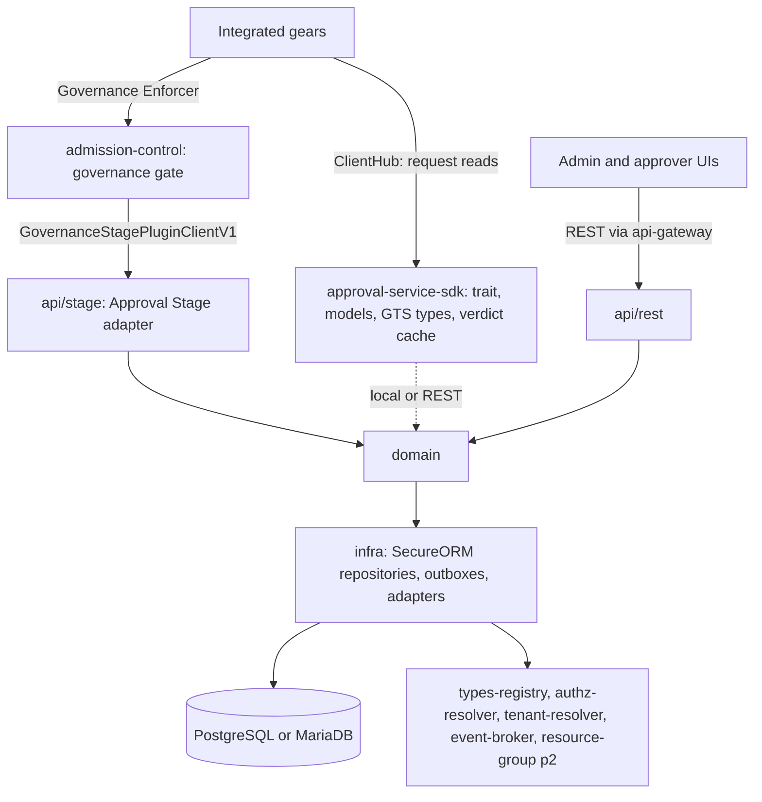

- [ ] `p1` - **ID**: `cpt-cf-approval-service-tech-layers`

| Layer | Responsibility | Technology |
|-------|---------------|------------|
| SDK (`approval-service-sdk/`) | `ApprovalServiceClient` trait, models, errors, GTS type structs, verdict cache | Rust; `toolkit-gts` `#[gts_type_schema]` |
| Presentation (`api/rest/`) | REST under `/approval-service/v1`, DTOs, OData, RFC 9457 errors | ToolKit `OperationBuilder`, `toolkit-odata` |
| Stage (`api/stage/`) | `GovernanceStagePluginClientV1` implementation for `admission-control` | `admission-control-sdk`; ToolKit contract binding |
| Domain (`domain/`) | Verdict resolution, registration, decisions, requests, governance, reconciliation planning | Rust `#[domain_model]`; `gts-rust` for parsing and matching; CEL (p2) |
| Infrastructure (`infra/`) | Repositories, migrations, event producer, reconciliation queue, platform adapters | SeaORM via secure ORM; `event-broker-sdk` outbox; `toolkit-db` outbox |

- [ ] `p2` - **ID**: `cpt-cf-approval-service-tech-cel-conditions`

Conditions (PRD leaves the language to DESIGN) use CEL through the workspace `cel-core` dependency, as Task Engine and Quota Enforcement do. Compiled and type-checked at save (invalid → `INVALID_CONDITION`), evaluated under `condition_cost_budget`; an evaluation error means "not matching". Inputs: `opportunity`, `subject`, `projection`, `context`.

## 2. Principles & Constraints

### 2.1 Design Principles

#### Live, Derived Verdicts

- [ ] `p1` - **ID**: `cpt-cf-approval-service-principle-live-verdicts`

Every uncached verdict is computed from committed state. Layers, policies, auto-approval rules, and decisions are stored once and never copied into each other or into requests; the only per-request copy is the p2 policy snapshot that the PRD mandates.

**ADRs**: None.

#### Fail Closed

- [ ] `p1` - **ID**: `cpt-cf-approval-service-principle-fail-closed`

Any unreliable input yields `unavailable`; transport errors, SDK errors, and unknown outcomes are refusals. Only a cached `approved`/`not_required` verdict within its lease survives an outage.

**ADRs**: None.

#### Approval Is Not Authorization

- [ ] `p1` - **ID**: `cpt-cf-approval-service-principle-not-authorization`

Who may check, request, approve, or administer is asked of the PDP per opportunity type. The service keeps no role model of its own and adds only restrictions (policies, approver lists, separation of duties, decision authority).

**ADRs**: None.

#### GTS Types Are the Extension Surface

- [ ] `p1` - **ID**: `cpt-cf-approval-service-principle-gts-extension`

Behaviour comes from resolved GTS schemas and traits, never from per-gear code. A new opportunity or projection type changes no API, table, or handler.

**ADRs**: None.

#### One Change, One Transaction

- [ ] `p1` - **ID**: `cpt-cf-approval-service-principle-single-transaction`

A change, its change sequence, audit record, events, and reconciliation jobs commit together. No network call runs inside the transaction.

**ADRs**: None.

### 2.2 Constraints

#### No Execution, Waiting, or Delivery

- [ ] `p1` - **ID**: `cpt-cf-approval-service-constraint-no-execution`

Per PRD §4.2 the gear owns no protected-operation execution, waiting, timers, notification delivery, group management, delegation, or e-signatures. Gears wait by polling or by consuming request events. PRD §4.3 future items are not designed.

**ADRs**: None.

#### PostgreSQL and MariaDB Parity

- [ ] `p1` - **ID**: `cpt-cf-approval-service-constraint-dual-database`

No partial or expression indexes and no dialect SQL. "One active/open row" uniqueness uses nullable key columns with plain unique indexes; long identities are indexed by SHA-256 columns.

**ADRs**: None.

#### Secure-by-Default Data Path

- [ ] `p1` - **ID**: `cpt-cf-approval-service-constraint-secure-orm`

All access goes through `SecureConn`/`SecureTx` with an `AccessScope` from `PolicyEnforcer`. Only catalog and counter tables are `unrestricted`; background workers use the system scope only for reconciliation, expiry, and retention.

**ADRs**: None.

#### Platform Event Delivery

- [ ] `p1` - **ID**: `cpt-cf-approval-service-constraint-event-broker-sdk`

Events go only through the Event Broker SDK managed outbox; no hand-rolled outbox or relay.

**ADRs**: None.

#### Static Configuration Layer

- [ ] `p1` - **ID**: `cpt-cf-approval-service-constraint-static-config`

The service reads configuration-file platform rules, platform defaults and policies only when it starts. Editing the file has no effect until the service restarts. At startup, the service compares the file digest with the last applied digest. If they differ, it must:

1. apply each added, changed, or removed rule and policy once;
2. increase `verdict_version`;
3. publish one `rule_changed` or `policy_changed` event for each changed entry; and
4. re-evaluate all open approval requests.

During a rolling restart, some replicas may still use the old file while others use the new one. Deployments must therefore treat a configuration change as temporarily inconsistent until every replica has restarted.

**ADRs**: None.

## 3. Technical Architecture

### 3.1 Domain Model

**Technology**: GTS (JSON Schema draft-07 types and instances); Rust `#[domain_model]` (gear) and `#[gts_type_schema]` (SDK).

**Location**: [schemas/schemas/](../schemas/schemas/) (types), [schemas/instances/](../schemas/instances/) (instances). Field-level detail lives in §3.7.

**Core Entities**:

- [ ] `p1` - **ID**: `cpt-cf-approval-service-entity-opportunity`
- [ ] `p1` - **ID**: `cpt-cf-approval-service-entity-projection`
- [ ] `p1` - **ID**: `cpt-cf-approval-service-entity-subject`
- [ ] `p1` - **ID**: `cpt-cf-approval-service-entity-rule`
- [ ] `p1` - **ID**: `cpt-cf-approval-service-entity-policy`
- [ ] `p2` - **ID**: `cpt-cf-approval-service-entity-auto-approval-rule`
- [ ] `p1` - **ID**: `cpt-cf-approval-service-entity-decision`
- [ ] `p1` - **ID**: `cpt-cf-approval-service-entity-request`
- [ ] `p1` - **ID**: `cpt-cf-approval-service-entity-verdict`
- [ ] `p1` - **ID**: `cpt-cf-approval-service-entity-audit-record`
- [ ] `p3` - **ID**: `cpt-cf-approval-service-entity-recertification-campaign`

| Entity | Purpose and required behavior | Schema |
|--------|-------------------------------|--------|
| Opportunity | Describes a gear operation that the Approval Service can check. The gear that first registers the derived GTS type owns it. Its GTS traits define the allowed subjects and projections, default action, decision authority, and standing-approval setting; see `cpt-cf-approval-service-design-gts-model`. | [opportunity.v1~](../schemas/schemas/gts.cf.core.approval.opportunity.v1~.schema.json) |
| Resource Projection | Identifies the external resource being acted on by its type, owning tenant, resource ID, and version. It is either `active` or `deregistered`. If a gear registers the same external resource after deregistration, the service creates a new projection record with a new ID. The old `deregistered` record stays unchanged for audit history. | [projection.v1~](../schemas/schemas/gts.cf.core.approval.projection.v1~.schema.json) |
| Subject | Identifies who needs approval by GTS type, tenant, and ID. Types listed in `tenant_subject_types` represent an entire tenant. Group subject types represent all group members in p2. | Embedded in request and decision |
| Rule | Decides whether an operation is denied, needs approval, or needs no approval. A rule is a platform rule (configuration file, binds every tenant) or a tenant rule (runtime); when no rule decides, the platform default or the gear default applies (PRD rule order). Its action is `deny`, `require_approval`, or `not_required`. | [rule.v1~](../schemas/schemas/gts.cf.core.approval.rule.v1~.schema.json) |
| Approval Policy | Defines which approvals are needed after a rule returns `require_approval`. A policy comes from runtime governance or configuration, has one stage in p1 and ordered stages later, may limit the approval lease, and is versioned. | [policy.v1~](../schemas/schemas/gts.cf.core.approval.policy.v1~.schema.json) |
| Auto-Approval Rule | In p2, automatically approves a matching request or prevents descendant tenants from auto-approving it. The rule can be enabled or disabled and may have a condition. | [auto_approval_rule.v1~](../schemas/schemas/gts.cf.core.approval.auto_approval_rule.v1~.schema.json) |
| Decision | Records one approver's `approve` or `deny` for a specific opportunity, projection, subject, and scope tenant. Only one decision for that exact key may be `active`. An approval linked to a request applies only while its context fingerprint matches. | [decision.v1~](../schemas/schemas/gts.cf.core.approval.decision.v1~.schema.json) |
| Approval Request | Tracks a pending approval for one opportunity, projection, and subject. Only one open request may exist for that key. Once closed, the same request cannot be opened again. | [request.v1~](../schemas/schemas/gts.cf.core.approval.request.v1~.schema.json) |
| Verdict | Is the current answer to a verification call. It is calculated when requested and is not stored. Every answer includes `verdict_version`; an `invalid` answer uses the catalog version and an `unavailable` answer uses `0`. | [verdict.v1~](../schemas/schemas/gts.cf.core.approval.verdict.v1~.schema.json) |
| Audit Record | Stores an immutable history entry for a governance or request change. Records are append-only and can be read only through the audit API. | Internal (`cpt-cf-approval-service-dbtable-audit-record`) |
| Recertification Campaign | In p3, groups periodic reviews of active approvals. Each campaign item refers to one active approve decision. Rejecting an item revokes that decision through the normal revocation flow. | Internal (`cpt-cf-approval-service-dbtable-recertification-campaign`) |

**Relationships**:

- Decisions and requests reference one projection row and are archived or closed with it; an approve may reference the open request of its key.
- Rules, policies, and auto-approval rules match opportunities and projections by GTS pattern or one projection ID; no foreign keys.
- Every change creates its audit record, events, and reconciliation job in the same transaction.

Decision lifecycle (PRD `cpt-cf-approval-service-fr-submit-decision`); only `active` applies:

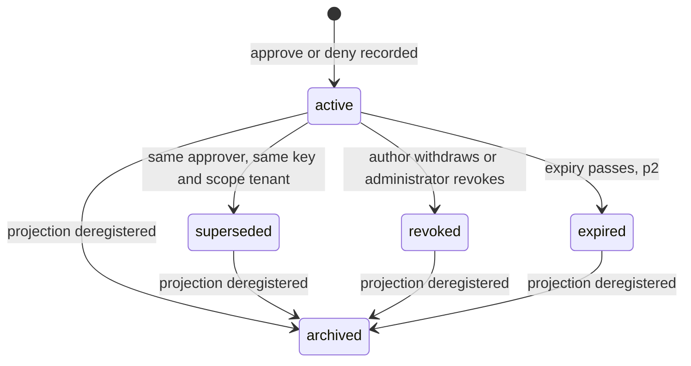

Request lifecycle; each close publishes one `request_closed` per target tenant:

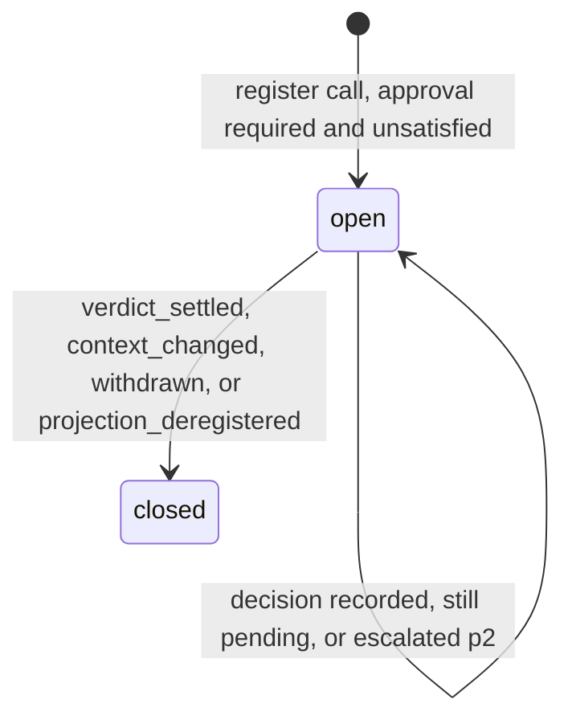

`cpt-cf-approval-service-upreq-lifecycle` maps as: *pending* = open request, *approved*/*rejected* = outcomes `approved`/`denied`, *revoked* = revoked decision, re-approval = a new decision.

#### GTS Type Model

- [ ] `p1` - **ID**: `cpt-cf-approval-service-design-gts-model`

Own types use `gts.cf.core.approval.<type>.v1~` (one wildcard covers them in access policies); events derive as `gts.cf.core.events.event.v1~cf.core.approval.<event>.v1~` (§3.3); permissions are `gts.cf.toolkit.authz.permission.v1~cf.approval_service._.<name>.v1` (`cpt-cf-approval-service-design-permissions`). Gear types are major-only; derivation depth is at most two.

| GTS identifier | Kind | Traits or role | File |
|----------------|------|----------------|------|
| `gts.cf.core.approval.opportunity.v1~` | Abstract base, extension point | `context` validated against the `facts` of the current version of the Governed Operation family named by the required `governed_operation` trait; traits `default_action` and `standing_approvals` (required, no default), `decision_authority` (default `subject_tenant`), `accepted_projection_types`, `resource_projections` (resource type → projection type), `accepted_subject_types`, `display_name` | [schema](../schemas/schemas/gts.cf.core.approval.opportunity.v1~.schema.json) |
| `gts.cf.core.approval.projection.v1~` | Abstract base, extension point | Closed: derived types add identity only, no properties or traits | [schema](../schemas/schemas/gts.cf.core.approval.projection.v1~.schema.json) |
| `gts.cf.core.approval.{request,decision,rule,policy,auto_approval_rule}.v1~` | Entity types, anonymous UUID instances | PDP resource types and event subject types | [request](../schemas/schemas/gts.cf.core.approval.request.v1~.schema.json), [decision](../schemas/schemas/gts.cf.core.approval.decision.v1~.schema.json), [rule](../schemas/schemas/gts.cf.core.approval.rule.v1~.schema.json), [policy](../schemas/schemas/gts.cf.core.approval.policy.v1~.schema.json), [auto_approval_rule](../schemas/schemas/gts.cf.core.approval.auto_approval_rule.v1~.schema.json) |
| `gts.cf.core.approval.verdict.v1~` | Contract type | Verification response | [schema](../schemas/schemas/gts.cf.core.approval.verdict.v1~.schema.json) |
| `gts.cf.core.events.topic.v1~cf.core.approval.approval_events.v1` | Topic instance | Outbound topic for all events | [instance](../schemas/instances/gts.cf.core.events.topic.v1~cf.core.approval.approval_events.v1.json) |
| `gts.cf.core.events.event.v1~`, `gts.cf.core.events.topic.v1~`, `gts.cf.toolkit.authz.permission.v1~`, `gts.cf.core.errors.err.v1~` | Referenced platform types | Event base, topic type, permission type, RFC 9457 error types | Platform-owned |

For every identifier received through an API, the service follows this order: parse it, look it up in Types Registry, check that it is valid for the operation, check the caller's permission, then save it. For a concrete GTS type, the database stores the Types Registry UUID and a readable type-ID column. For a GTS pattern, the database stores the pattern text; the service matches it in Rust with `gts-rust`, not with SQL `LIKE`. The service publishes events but does not subscribe to any, so it has no consumer-group instance.

#### Extension Points for Consuming Gears

- [ ] `p1` - **ID**: `cpt-cf-approval-service-design-gts-extension-points`

The PRD needs two extension points and no plugin.

| Extension point | Gear registers | Service validates | Example |
|-----------------|----------------|-------------------|---------|
| Approval Opportunity | One derived type per gated operation in `<gear>-sdk`, naming its Governed Operation type | Derivation, required traits, the Governed Operation family exists, has the same owner, and has no other opportunity, `resource_projections` maps only to accepted projection types, accepted projection types under the projection base, context profile, PDP `register`, ownership | `gts.cf.core.approval.opportunity.v1~cf.procurement._.po_release.v1~` |
| Resource Projection type | One derived type per approvable resource kind | Derivation, ownership | `gts.cf.core.approval.projection.v1~cf.procurement._.purchase_order.v1~` |

- **Activation**: the gear publishes types through its Types Registry inventory, then calls `register_types` from a supervised start-up task.
- **Ownership**: the first service identity that registers a type owns it (`NOT_TYPE_OWNER` for others), like the Types Registry `publisher_name` rule; transfer is an operator action.
- **Context profile**: the `facts` schema of the current version of the named Governed Operation family, which must be a closed object of strings, numbers, integers, booleans, or arrays of those; `writeOnly` and `format: password` rejected; size ≤ `context_max_bytes`. Per-attribute traits come from that type: `tier`, `approver_visible`, `sensitive`, `binding` (default `true`).
- **Evolution**: trait changes and new optional attributes take effect on re-registration (audit, `opportunity_changed`, reconciliation). Attributes change with the Governed Operation type version, and a renamed attribute stays readable under its old name. Narrowing accepted types needs a new major. A timer reports registry drift (`apsv_opportunity_drift_total`) without changing behaviour.
- **Gear-owned permissions**: a gear may ship permission instances narrowed to its opportunity types; the PDP covers derived types implicitly.

#### Permissions

- [ ] `p1` - **ID**: `cpt-cf-approval-service-design-permissions`

Declared with `gts_instance!` and published through the gear's Types Registry inventory. Opportunity-scoped checks pass the concrete opportunity type; a wildcard governance pattern is checked against the base type. Tenant limits come from PDP constraints compiled into `AccessScope`.

| Permission | Resource type | Action | Gates |
|------------|---------------|--------|-------|
| [opportunity_register](../schemas/instances/gts.cf.toolkit.authz.permission.v1~cf.approval_service._.opportunity_register.v1.json) | opportunity | `register` | `register_types` |
| [opportunity_read](../schemas/instances/gts.cf.toolkit.authz.permission.v1~cf.approval_service._.opportunity_read.v1.json) | opportunity | `read` | Opportunity browsing |
| [verdict_check](../schemas/instances/gts.cf.toolkit.authz.permission.v1~cf.approval_service._.verdict_check.v1.json) | opportunity | `check` | Verification and batch; never deciding |
| [request_open](../schemas/instances/gts.cf.toolkit.authz.permission.v1~cf.approval_service._.request_open.v1.json) | opportunity | `request` | The register option |
| [decision_approve](../schemas/instances/gts.cf.toolkit.authz.permission.v1~cf.approval_service._.decision_approve.v1.json) | opportunity | `approve` | Recording and withdrawing own decisions, bulk, inbox |
| [decision_on_behalf](../schemas/instances/gts.cf.toolkit.authz.permission.v1~cf.approval_service._.decision_on_behalf.v1.json) | opportunity | `decide_on_behalf` | p2 on-behalf decisions, with the named user's `approve` |
| [governance_administer](../schemas/instances/gts.cf.toolkit.authz.permission.v1~cf.approval_service._.governance_administer.v1.json) | opportunity | `administer` | Rules, policies, auto-approval rules, revoking any decision, withdrawing any request, campaigns (p3) |
| [governance_read](../schemas/instances/gts.cf.toolkit.authz.permission.v1~cf.approval_service._.governance_read.v1.json) | opportunity | `read_governance` | Governance reads, `:explain`, access review (p2) |
| [audit_read](../schemas/instances/gts.cf.toolkit.authz.permission.v1~cf.approval_service._.audit_read.v1.json) | opportunity | `read_audit` | Audit reads; context and justification only with `approve` or `administer` |
| [projection_register](../schemas/instances/gts.cf.toolkit.authz.permission.v1~cf.approval_service._.projection_register.v1.json), [projection_deregister](../schemas/instances/gts.cf.toolkit.authz.permission.v1~cf.approval_service._.projection_deregister.v1.json) | projection | `register`, `deregister` | Projection writes, plus ownership |
| [projection_read](../schemas/instances/gts.cf.toolkit.authz.permission.v1~cf.approval_service._.projection_read.v1.json) | projection | `read` | Projection browsing |
| [request_read](../schemas/instances/gts.cf.toolkit.authz.permission.v1~cf.approval_service._.request_read.v1.json) | request | `read` | Request reads, plus row rule (§4.2) |
| [request_withdraw](../schemas/instances/gts.cf.toolkit.authz.permission.v1~cf.approval_service._.request_withdraw.v1.json), [request_escalate](../schemas/instances/gts.cf.toolkit.authz.permission.v1~cf.approval_service._.request_escalate.v1.json) | request | `withdraw`, `escalate` | Withdrawal; p2 escalation; plus row rule |
| [decision_read](../schemas/instances/gts.cf.toolkit.authz.permission.v1~cf.approval_service._.decision_read.v1.json) | decision | `read` | Decision reads |

### 3.2 Component Model

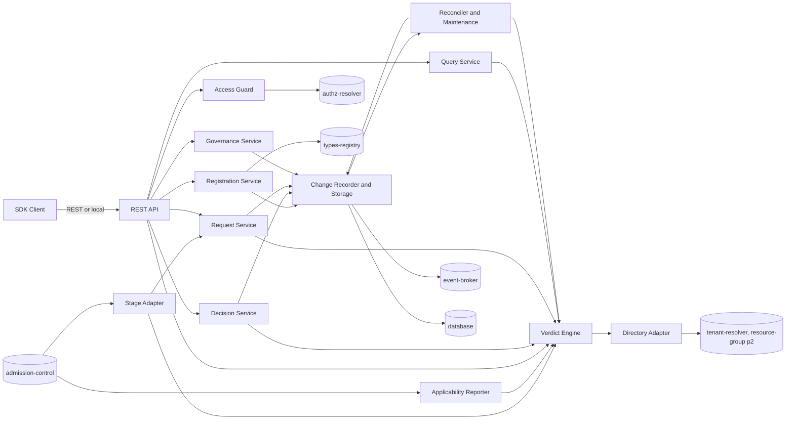

#### Approval Stage Adapter

- [ ] `p1` - **ID**: `cpt-cf-approval-service-component-stage-adapter`

##### Why this component exists

Serves verification to the governance gate as the Approval Stage (`cpt-cf-approval-service-contract-approval-stage`).

##### Responsibility scope

- Registers the `GovernanceStagePluginClientV1` instance: kind `approval`, last in order, with side effects, Preview supported.
- Maps an enforce evaluation to verification with the register option, a Preview to verification without it, and a batch Preview to batch verification.
- Builds each verification from the check alone: opportunity by the Governed Operation family (none → `not_required`); subject from the `SecurityContext`; projection type from the opportunity's `resource_projections` for the check's resource type (none → `invalid`), with the check's resource ID, tenant, and Resource Version as the projection's ID, tenant, and version; context attributes from the check's Facts.
- Maps verdicts to stage results and obligations: request reference, unmet requirements, approval lease.

##### Responsibility boundaries

No caching and no ordering against other stages; the gate owns both.

##### Related components (by ID)

- `cpt-cf-approval-service-component-request-service` — calls with the register option
- `cpt-cf-approval-service-component-verdict-engine` — calls without it

#### Applicability Reporter

- [ ] `p1` - **ID**: `cpt-cf-approval-service-component-applicability`

##### Why this component exists

Lets ungoverned operations skip the gate (`cpt-cf-approval-service-fr-applicability`).

##### Responsibility scope

- For each opportunity and tenant scope, reports whether any rule, platform default, gear default, or deny decision can give an outcome other than `not_required`.
- Reports the context attributes read by parsed CEL conditions of applicable rules, policies, and auto-approval rules, plus attributes declared as shown to approvers.
- Uses the global change sequence as the applicability version; change events already published after commit serve as change notices.

##### Responsibility boundaries

Reads committed governance only; never evaluates a subject.

##### Related components (by ID)

- `cpt-cf-approval-service-component-verdict-engine` — shares the governance snapshot

#### SDK Client and Verdict Cache

- [ ] `p1` - **ID**: `cpt-cf-approval-service-component-sdk-client`

##### Why this component exists

Typed access for the stage adapter's remote mode and for gears that read requests (`cpt-cf-approval-service-interface-sdk`). Gears gate operations through the Governance Enforcer, which applies the same lease-bounded caching.

##### Responsibility scope

- `ApprovalServiceClient` trait, models, errors, and base GTS structs in `approval-service-sdk`.
- Caches `approved`/`not_required` keyed by caller, opportunity, subject, projection, and fingerprint until lease end; skips register and bypass calls; ignores responses older than a seen `verdict_version`.
- Maps transport errors and unknown outcomes to an `unavailable` refusal.

##### Responsibility boundaries

No rule evaluation, no event consumption (`invalidate` helper only), no write retries.

##### Related components (by ID)

- `cpt-cf-approval-service-component-rest-api` — calls (remote mode); in-process it uses the local client.

#### REST API

- [ ] `p1` - **ID**: `cpt-cf-approval-service-component-rest-api`

##### Why this component exists

HTTP surface for administrators, approvers, and out-of-process gears (`cpt-cf-approval-service-interface-rest-api`).

##### Responsibility scope

`OperationBuilder` routes with schemas, OData, `If-Match`, `Idempotency-Key`, and RFC 9457 problems; DTO to command mapping.

##### Responsibility boundaries

No business rules and no direct database access.

##### Related components (by ID)

- `cpt-cf-approval-service-component-access-guard`, `cpt-cf-approval-service-component-registration-service`, `cpt-cf-approval-service-component-verdict-engine`, `cpt-cf-approval-service-component-decision-service`, `cpt-cf-approval-service-component-request-service`, `cpt-cf-approval-service-component-governance-service`, `cpt-cf-approval-service-component-query-service` — calls

#### Access Guard

- [ ] `p1` - **ID**: `cpt-cf-approval-service-component-access-guard`

##### Why this component exists

Consistent PDP enforcement and approval-specific restrictions (`cpt-cf-approval-service-fr-validate-eligibility`).

##### Responsibility scope

- Wraps `PolicyEnforcer`; builds resource types and properties (`owner_tenant_id`, `projection_type`, `resource_tenant_id`, `resource_id`); returns `AccessScope`.
- Request row rule and field redaction (§4.2), separation of duties, owner-only decision authority.

##### Responsibility boundaries

Never builds an `AccessScope` by hand; never decides verdicts.

##### Related components (by ID)

- `cpt-cf-approval-service-component-directory-adapter` — depends on (ancestry for authority checks)

#### Registration Service

- [ ] `p1` - **ID**: `cpt-cf-approval-service-component-registration-service`

##### Why this component exists

Type and projection registration by owners only (`cpt-cf-approval-service-fr-register-req-type`, `cpt-cf-approval-service-fr-resource-projection`).

##### Responsibility scope

- Resolves and validates types from Types Registry, binds ownership, upserts catalog rows with a trait diff.
- Registers, re-registers, and deregisters projections (archive decisions, close requests); runs the drift check.

##### Responsibility boundaries

Never publishes types to Types Registry for gears; never deletes opportunities (no PRD removal).

##### Related components (by ID)

- `cpt-cf-approval-service-component-change-recorder` — calls

#### Verdict Engine

- [ ] `p1` - **ID**: `cpt-cf-approval-service-component-verdict-engine`

##### Why this component exists

Executes `cpt-cf-approval-service-fr-verdict-resolution` on the hot path; absorbs the governance cache and condition evaluator.

##### Responsibility scope

- Runs the PRD steps. Validation reasons: `unknown_opportunity`, `unaccepted_projection_type`, `unaccepted_subject_type`, `invalid_context`. Specificity: projection ID beats patterns; more fixed GTS segments beat fewer; then opportunity pattern, then subject type pattern (p2); ties pick the stricter action; p3 `overridable` ancestor rules may be relaxed.
- A bound approve counts only when its fingerprint equals the call's; a standing approve only while the opportunity allows standing approvals; expired (p2) never counts. Owner-only with the resource tenant off the path returns `approval_required` with `owner_approval_unreachable`.
- Computes unmet requirements, the lease, and `verdict_version` (maximum change sequence over catalog, ancestor governance versions, projection, candidate decision rows, request row).
- Holds per-tenant immutable snapshots (rules, policies, auto-approval rules with compiled CEL, configuration layer, catalog) revalidated by one `apsv_governance_version` read per call; LRU bound `governance_cache_max_tenants`. Evaluates p2 conditions (`cpt-cf-approval-service-tech-cel-conditions`).

##### Responsibility boundaries

Read-only; never opens requests; never calls the PDP (callers authorize first).

##### Related components (by ID)

- `cpt-cf-approval-service-component-directory-adapter` — calls
- `cpt-cf-approval-service-component-change-recorder` — reads through its repositories

#### Directory Adapter

- [ ] `p1` - **ID**: `cpt-cf-approval-service-component-directory-adapter`

##### Why this component exists

Tenant ancestry and, in p2, group membership (`cpt-cf-approval-service-fr-tenant-hierarchy`, `cpt-cf-approval-service-contract-group-source`).

##### Responsibility scope

Tenant Resolver and Resource Group SDK calls with bounded caches (`tenant_ancestry_cache_ttl_secs`, `group_membership_cache_ttl_secs`); explicit unavailability; a flat deployment is a one-tenant path.

##### Responsibility boundaries

Manages no tenants or groups; never guesses a path.

##### Related components (by ID)

- `cpt-cf-approval-service-component-verdict-engine`, `cpt-cf-approval-service-component-access-guard` — called by

#### Decision Service

- [ ] `p1` - **ID**: `cpt-cf-approval-service-component-decision-service`

##### Why this component exists

Records, withdraws, and revokes decisions, including bulk and p2 on-behalf (`cpt-cf-approval-service-fr-submit-decision`, `cpt-cf-approval-service-fr-bulk-approve`, `cpt-cf-approval-service-fr-on-behalf-decision`).

##### Responsibility scope

- Checks reason, request reference, standing setting, lease and expiry limits, decision authority, and separation of duties (approver is not the subject, the requester of the key's open request, or a member of a group subject).
- Supersedes the approver's own active decision, settles the key's open request in the same transaction, and enqueues reconciliation for wider scope.

##### Responsibility boundaries

Computes no verdicts itself; an approver cannot revoke another approver's decision.

##### Related components (by ID)

- `cpt-cf-approval-service-component-verdict-engine`, `cpt-cf-approval-service-component-change-recorder` — calls

#### Request Service

- [ ] `p1` - **ID**: `cpt-cf-approval-service-component-request-service`

##### Why this component exists

Request opening by register calls, withdrawal, and p2 escalation (`cpt-cf-approval-service-fr-create-request`, `cpt-cf-approval-service-fr-request-escalation`).

##### Responsibility scope

- On a valid register call: upserts the projection, closes an open request with another fingerprint, opens a request when the verdict is `approval_required` (unique `open_key`), stores the p2 policy snapshot, audits p2 automatic approvals.
- Withdrawal and escalation with row-rule checks.

##### Responsibility boundaries

Never waits for decisions; signals only through events.

##### Related components (by ID)

- `cpt-cf-approval-service-component-verdict-engine`, `cpt-cf-approval-service-component-change-recorder` — calls

#### Governance Service

- [ ] `p1` - **ID**: `cpt-cf-approval-service-component-governance-service`

##### Why this component exists

Runtime rules, policies, and auto-approval rules (`cpt-cf-approval-service-fr-approval-rules`, `cpt-cf-approval-service-fr-approval-policies`, `cpt-cf-approval-service-fr-auto-approval`).

##### Responsibility scope

Validates patterns, selectors, stages, lease maxima, and conditions; enforces `If-Match` and reasons; bumps the tenant governance version; enqueues reconciliation for old and new patterns.

##### Responsibility boundaries

Never edits configuration or gear-default layers; descendants only add policies at their own scope.

##### Related components (by ID)

- `cpt-cf-approval-service-component-change-recorder` — calls

#### Query Service

- [ ] `p1` - **ID**: `cpt-cf-approval-service-component-query-service`

##### Why this component exists

Browsing, explanation, inbox, and access review (`cpt-cf-approval-service-fr-administration`, `cpt-cf-approval-service-fr-access-review`).

##### Responsibility scope

- OData lists within PDP scope; configuration and gear-default rules shown read-only; `:explain` with the full resolution trace.
- Inbox: every open request in the caller's `approve` scope, with context, justification, unmet requirements (current stage only, p2), escalation marker, and whether the caller's approval would count.

##### Responsibility boundaries

Read-only.

##### Related components (by ID)

- `cpt-cf-approval-service-component-verdict-engine` — calls
- `cpt-cf-approval-service-component-change-recorder` — reads through its repositories

#### Change Recorder and Storage

- [ ] `p1` - **ID**: `cpt-cf-approval-service-component-change-recorder`

##### Why this component exists

Atomic change, audit, events, and reconciliation work (`cpt-cf-approval-service-nfr-atomicity`) on tenant-scoped storage (`cpt-cf-approval-service-constraint-secure-orm`); absorbs the event publisher and storage.

##### Responsibility scope

- In the caller's `SecureTx`: increments `apsv_change_counter`, stamps rows, bumps governance versions, appends audit, enqueues events and reconciliation jobs (queue `apsv-reconcile`).
- Owns the Event Broker `DbProducer` (identity `approval-service`): maps typed events to GTS event types and sets tenant, subject, and subject type; the SDK owns delivery, retries, and dead letters.
- Owns `Scopable` SeaORM entities, repositories, and migrations (including the outbox libraries') via `DatabaseCapability::migrations()`.

##### Responsibility boundaries

No network call inside the transaction; no raw connections; a broker authorization refusal dead-letters and alerts, never rolls back.

##### Related components (by ID)

- `cpt-cf-approval-service-component-reconciler` — enqueues to

#### Reconciler and Maintenance

- [ ] `p1` - **ID**: `cpt-cf-approval-service-component-reconciler`

##### Why this component exists

Background work outside change transactions: request reconciliation (`cpt-cf-approval-service-fr-request-reconciliation`), retention (`cpt-cf-approval-service-nfr-data-classification`), p2 expiry; absorbs the maintenance worker.

##### Responsibility scope

- Reconciliation: leased jobs on every replica, scoped by opportunity set, tenant subtree, projection, or subject set; pages open requests by ID, evaluates with stored context, closes with a `status = open` guard, enqueues a cursor continuation before acknowledging; retries `unavailable` with backoff.
- Periodic tasks (lease or advisory lock): startup configuration digest check; `expired` transitions with `decision_expired` (p2); purge of request context, justification, and audit past `audit_retention_days`; idempotency-key cleanup; p3 campaign deadlines.

##### Responsibility boundaries

Never opens requests or changes governance; verification never depends on it.

##### Related components (by ID)

- `cpt-cf-approval-service-component-verdict-engine`, `cpt-cf-approval-service-component-change-recorder` — calls

### 3.3 API Contracts

#### REST Endpoints

- [ ] `p1` - **ID**: `cpt-cf-approval-service-interface-rest-endpoints`

- **Contracts**: `cpt-cf-approval-service-contract-verification`
- **Implements**: `cpt-cf-approval-service-interface-rest-api`
- **Technology**: REST/OpenAPI via `OperationBuilder`; JSON snake_case; RFC 9457
- **Location**: generated `/openapi.json`; base path `/approval-service/v1`

**Endpoints Overview**:

| Method | Path | Description | Permission | Stability |
|--------|------|-------------|------------|-----------|
| `POST` | `/opportunities:register` | Register or update own opportunity and projection types | `opportunity_register` + ownership | stable |
| `GET` | `/opportunities`, `/opportunities/{opportunity_type}` | List, get | `opportunity_read` | stable |
| `POST` | `/projections:register`, `/projections:deregister` | Batch projection writes (`projection_batch_max_items`) | `projection_register` / `projection_deregister` + ownership | stable |
| `GET` | `/projections`, `/projections/{projection_id}` | List by type and resource tenant, get | `projection_read` | stable |
| `POST` | `/verifications` | Verify; `register: true` also registers and opens a request | `verdict_check` (+ `request_open`) | stable |
| `POST` | `/verifications:batch` | Read-only batch for one opportunity and subject | `verdict_check` | stable |
| `POST` | `/verifications:explain` | Side-effect-free verdict with trace | `governance_read` | stable |
| `GET` | `/requests`, `/requests/{request_id}` | List, read with current outcome | `request_read` + row rule | stable |
| `POST` | `/requests/{request_id}:withdraw` | Withdraw | `request_withdraw` + row rule | stable |
| `POST` | `/requests/{request_id}:escalate` | Escalate with reason (p2) | `request_escalate` + row rule | unstable |
| `GET` | `/inbox/requests` | Approver inbox | `decision_approve` scope | stable |
| `POST` | `/decisions`, `/decisions:bulk` | Record one (`on_behalf_of` in p2) or many atomically | `decision_approve` (+ `decision_on_behalf`) | stable |
| `GET` | `/decisions`, `/decisions/{decision_id}` | List, get | `decision_read` | stable |
| `POST` | `/decisions/{decision_id}:revoke` | Withdraw own or revoke as administrator | author with `decision_approve`, or `governance_administer` | stable |
| `GET`, `POST` | `/rules` | List all layers; create runtime rule | `governance_read`; `governance_administer` | stable |
| `GET`, `PATCH`, `POST` | `/rules/{rule_id}`, `/rules/{rule_id}:delete` | Get; change or delete (`If-Match`, reason) | `governance_read`; `governance_administer` | stable |
| `GET`, `POST`, `PATCH` | `/policies`, `/policies/{policy_id}`, `/policies/{policy_id}:delete` | Same pattern as rules | as rules | stable |
| `GET`, `POST`, `PATCH` | `/auto-approval-rules`, `/auto-approval-rules/{rule_id}`, `…:delete` | Same pattern, plus enable and disable (p2) | as rules | unstable |
| `GET` | `/audit-records` | Audit trail | `audit_read` + scope | stable |
| `GET` | `/reports/access-review` | Access review report (p2) | `governance_read` | unstable |
| `GET`, `POST` | `/recertification-campaigns`, `.../items/{item_id}:confirm`, `:revoke` | Campaigns (p3) | `governance_read`; `governance_administer` | unstable |

- **Verification request**: `opportunity_type`, `subject`, `projection` (`display_name` required with `register`), `context`, `register`, `justification`, `correlation_id`. The requester is the call's authenticated subject. `invalid` and `unavailable` are HTTP 200 verdicts; only malformed bodies (400) and a missing `check` (403) are errors.
- **Lists**: OData filter, orderby, select; cursor pagination (default 50, maximum 200); wildcard type filters expand through the catalog.
- **Idempotency**: request opening is idempotent by `open_key`. Decision, bulk, create, withdraw, escalate, and revoke calls accept `Idempotency-Key` (stored `idempotency_retention_hours`; a reused key with another body is rejected).
- **Concurrency**: governance resources return `ETag` from `row_version`; `PATCH` and `:delete` require `If-Match`.

**Error catalogue** (`type` = `gts://gts.cf.core.errors.err.v1~cf.core.err.<category>.v1~`; code in `context.reason`; no stack traces, SQL, or context values):

| Code | Category | HTTP | When |
|------|----------|------|------|
| `INVALID_GTS_ID` | `invalid_argument` | 400 | Identifier or pattern does not parse |
| `REASON_REQUIRED` | `invalid_argument` | 400 | Decision, revocation, escalation, or runtime governance change without reason |
| `INVALID_SELECTOR` | `invalid_argument` | 400 | Both or neither selector form |
| `INVALID_CONDITION` | `invalid_argument` | 400 | Condition fails to compile (p2) |
| `BATCH_LIMIT_EXCEEDED` | `out_of_range` | 400 | List above its configured limit |
| `LEASE_ABOVE_MAXIMUM` | `out_of_range` | 400 | Lease or policy maximum above `max_lease_secs` |
| `INVALID_OPPORTUNITY_DECLARATION` | `failed_precondition` | 400 | Missing required trait, wrong base, unknown accepted type, or bad context profile |
| `TYPE_NOT_ADMITTED` | `failed_precondition` | 400 | Type not yet admitted in Types Registry |
| `STANDING_APPROVAL_PROHIBITED` | `failed_precondition` | 400 | Approve without request where standing approvals are prohibited |
| `REQUEST_NOT_OPEN` | `failed_precondition` | 400 | Referenced request closed or of another key |
| `DECISION_NOT_ACTIVE` | `failed_precondition` | 400 | Revoking a non-active decision |
| `PROJECTION_NOT_REGISTERED` | `failed_precondition` | 400 | Decision on an unknown or deregistered projection |
| `BULK_ITEMS_REJECTED` | `failed_precondition` | 400 | Any bulk item failed; `context.items[]` lists all; nothing recorded |
| `IDEMPOTENCY_KEY_REUSED` | `failed_precondition` | 400 | Same key, different body |
| `PERMISSION_DENIED` | `permission_denied` | 403 | PDP denied |
| `NOT_TYPE_OWNER` | `permission_denied` | 403 | Caller does not own the type |
| `SEPARATION_OF_DUTIES` | `permission_denied` | 403 | Approver is the subject, the requester, or a member of a group subject |
| `DECISION_AUTHORITY` | `permission_denied` | 403 | Scope tenant violates decision authority |
| `NOT_FOUND` | `not_found` | 404 | Absent or outside scope |
| `ETAG_MISMATCH` | `aborted` | 412 | `If-Match` mismatch |
| `DEPENDENCY_UNAVAILABLE` | `service_unavailable` | 503 | Dependency failure on non-verification endpoints |

#### SDK Client

- [ ] `p1` - **ID**: `cpt-cf-approval-service-interface-sdk-client`

- **Contracts**: `cpt-cf-approval-service-contract-verification`
- **Implements**: `cpt-cf-approval-service-interface-sdk`
- **Technology**: ClientHub trait `ApprovalServiceClient`; local adapter in-process, REST client out-of-process
- **Location**: `gears/approval-service/approval-service-sdk/src/api.rs` (to be created)

| Method | Notes |
|--------|-------|
| `verify`, `verify_batch` | Return verdicts, never errors; options `register`, `bypass_cache`, `correlation_id`, `justification` |
| `register_types`, `register_projections`, `deregister_projections` | Owner writes |
| `get_request`, `withdraw_request`, `escalate_request` (p2) | Requester or opening gear |
| `record_decision_on_behalf`, `revoke_decision_on_behalf` | p2 |
| `invalidate` | Local cache helper for event consumers |

#### Approval Stage Contract

- [ ] `p1` - **ID**: `cpt-cf-approval-service-interface-approval-stage`

- **Contracts**: `cpt-cf-approval-service-contract-approval-stage`
- **Technology**: `GovernanceStagePluginClientV1` from `admission-control-sdk`; in-process or its REST or gRPC projection
- **Location**: `gears/approval-service/approval-service/src/api/stage/` (to be created)

| Method | Notes |
|--------|-------|
| `evaluate` | Enforce: verification with register option. Preview: read-only verification; a list of resources uses batch verification |
| `applicability` | Report since a change sequence |

#### GTS Type Registration Contract

- [ ] `p1` - **ID**: `cpt-cf-approval-service-interface-gts-registration`

- **Contracts**: `cpt-cf-approval-service-contract-verification`
- **Technology**: GTS types and traits via Types Registry, activated by `register_types`
- **Location**: [opportunity base](../schemas/schemas/gts.cf.core.approval.opportunity.v1~.schema.json), [projection base](../schemas/schemas/gts.cf.core.approval.projection.v1~.schema.json)

Rules in `cpt-cf-approval-service-design-gts-extension-points`. Additive traits within a base major; both majors accepted during a base migration.

#### Change Events

- [ ] `p1` - **ID**: `cpt-cf-approval-service-interface-change-events`

- **Contracts**: `cpt-cf-approval-service-contract-events`
- **Technology**: Event Broker; types derived from `gts.cf.core.events.event.v1~`; topic `gts.cf.core.events.topic.v1~cf.core.approval.approval_events.v1`
- **Location**: [schemas/schemas/](../schemas/schemas/)

| Event (`...cf.core.approval.<name>.v1~`) | Published when | Event subject / subject type | Tenant |
|------------------------------------------|----------------|------------------------|--------|
| [request_opened](../schemas/schemas/gts.cf.core.events.event.v1~cf.core.approval.request_opened.v1~.schema.json) | Register call opens a request | request ID / opportunity type | Subject tenant, plus requester tenant if different |
| [request_decided](../schemas/schemas/gts.cf.core.events.event.v1~cf.core.approval.request_decided.v1~.schema.json) | Decision on an open request's key, request stays open | same | same |
| [request_escalated](../schemas/schemas/gts.cf.core.events.event.v1~cf.core.approval.request_escalated.v1~.schema.json) | Escalation (p2) | same | same |
| [request_closed](../schemas/schemas/gts.cf.core.events.event.v1~cf.core.approval.request_closed.v1~.schema.json) | Any closure | same | same |
| [decision_recorded](../schemas/schemas/gts.cf.core.events.event.v1~cf.core.approval.decision_recorded.v1~.schema.json) | Decision becomes active (each bulk item) | decision ID / decision type | Scope tenant |
| [decision_revoked](../schemas/schemas/gts.cf.core.events.event.v1~cf.core.approval.decision_revoked.v1~.schema.json) | Decision revoked | same | Scope tenant |
| [decision_expired](../schemas/schemas/gts.cf.core.events.event.v1~cf.core.approval.decision_expired.v1~.schema.json) | Expiry committed (p2) | same | Scope tenant |
| [rule_changed](../schemas/schemas/gts.cf.core.events.event.v1~cf.core.approval.rule_changed.v1~.schema.json) | Runtime rule change; configuration rule change at startup | rule ID / rule type | Scope tenant |
| [policy_changed](../schemas/schemas/gts.cf.core.events.event.v1~cf.core.approval.policy_changed.v1~.schema.json) | Runtime policy change; configuration policy change at startup | policy ID / policy type | Scope tenant |
| [auto_approval_rule_changed](../schemas/schemas/gts.cf.core.events.event.v1~cf.core.approval.auto_approval_rule_changed.v1~.schema.json) | Any change incl. enable and disable (p2) | rule ID / auto-approval type | Scope tenant |
| [opportunity_changed](../schemas/schemas/gts.cf.core.events.event.v1~cf.core.approval.opportunity_changed.v1~.schema.json) | Opportunity registered or changed | opportunity type / base type | Root |
| [projection_deregistered](../schemas/schemas/gts.cf.core.events.event.v1~cf.core.approval.projection_deregistered.v1~.schema.json) | Projection deregistered | projection ID / projection type | Resource tenant |

- **Payload**: affected opportunity, projection or pattern, subject, scope tenant, `verdict_version`, `dedup_key` (UUIDv5 over sequence, type, entity, target tenant). Request events add outcome, close reason, cause, decisions with reasons, correlation ID. No context or justification.
- **Delivery**: enqueued in the change transaction, at least once after commit; partition key `/subject`. The publishing identity is a root-tenant service subject with `produce` on the topic, event types, and subject types for every tenant.
- **Consumers** need `consume` on event and subject type; a Task Engine wait needs it on `request_closed` with the opportunity type.
- **Consumed contract**: `cpt-cf-approval-service-contract-group-source` (p2), see §3.5.

### 3.4 Internal Dependencies

| Dependency Gear | Interface Used | Purpose |
|-------------------|----------------|----------|
| types-registry | `types-registry-sdk`, inventory publisher | Publish own types; resolve gear types; drift check |
| authz-resolver | `authz-resolver-sdk` `PolicyEnforcer` | PEP and `AccessScope` |
| tenant-resolver | `tenant-resolver-sdk` | Ancestors and descendants |
| event-broker | `event-broker-sdk` `DbProducer` (`outbox`) | Durable event publication |
| resource-group (p2) | Resource Group SDK | Group membership |
| api-gateway | ToolKit REST host | Routing, AuthN, `SecurityContext` |
| admission-control | `admission-control-sdk` | Stage contract; Governed Operation base type that opportunities extend |

**Dependency Rules** (per project conventions):

- No circular dependencies
- Always use sdk modules for inter-gear communication
- No cross-category sideways deps except through contracts
- Only integration/adapter gears talk to external systems
- `SecurityContext` must be propagated across all in-process calls

### 3.5 External Dependencies

No system outside the platform.

#### Platform Relational Database

- **Contract**: `cpt-cf-approval-service-contract-events` (event records share the change transaction)

| Dependency Gear | Interface Used | Purpose |
|-------------------|---------------|---------|
| PostgreSQL or MariaDB (runtime-managed) | `toolkit-db` `SecureConn`/`SecureTx` | Governance state, audit, outboxes |

#### Group Source

- **Contract**: `cpt-cf-approval-service-contract-group-source`

| Dependency Gear | Interface Used | Purpose |
|-------------------|---------------|---------|
| resource-group (p2) | Groups of a subject, members of a group | Group approvers and subject groups; failure yields `unavailable` |

**Dependency Rules**: as in §3.4.

### 3.6 Interactions & Sequences

#### Gear Registers Its Types at Startup

- [ ] `p1` - **ID**: `cpt-cf-approval-service-seq-type-registration`

**Use cases**: `cpt-cf-approval-service-usecase-register-and-approve`, `cpt-cf-approval-service-usecase-admin-override`

**Actors**: `cpt-cf-approval-service-actor-gear-vendor`, `cpt-cf-approval-service-actor-integrated-gear`

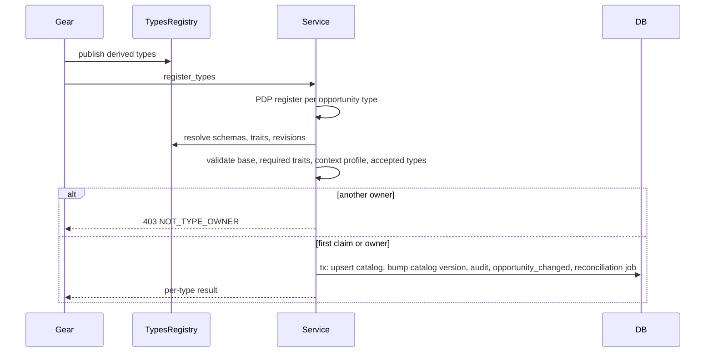

- A changed trait, such as `standing_approvals` → `prohibited`, applies from the next verification; open requests are reconciled.

#### Read-Only and Batch Verification

- [ ] `p1` - **ID**: `cpt-cf-approval-service-seq-verify-read-only`

**Use cases**: `cpt-cf-approval-service-usecase-repo-access`, `cpt-cf-approval-service-usecase-register-and-approve`, `cpt-cf-approval-service-usecase-tenant-approval`

**Actors**: `cpt-cf-approval-service-actor-governance-gate`, `cpt-cf-approval-service-actor-requester`

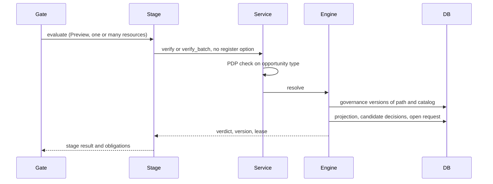

- Writes nothing; any dependency failure, including the PDP, yields `unavailable`.
- Batch: one permission check, one ancestry and snapshot read, one indexed query for all items; per-item verdicts equal separate calls (Model Registry listing).

#### Verification with Register Option

- [ ] `p1` - **ID**: `cpt-cf-approval-service-seq-verify-register`

**Use cases**: `cpt-cf-approval-service-usecase-register-and-approve`, `cpt-cf-approval-service-usecase-repo-access`, `cpt-cf-approval-service-usecase-policy-approval`, `cpt-cf-approval-service-usecase-admin-override`, `cpt-cf-approval-service-usecase-task-wait`

**Actors**: `cpt-cf-approval-service-actor-requester`, `cpt-cf-approval-service-actor-governance-gate`

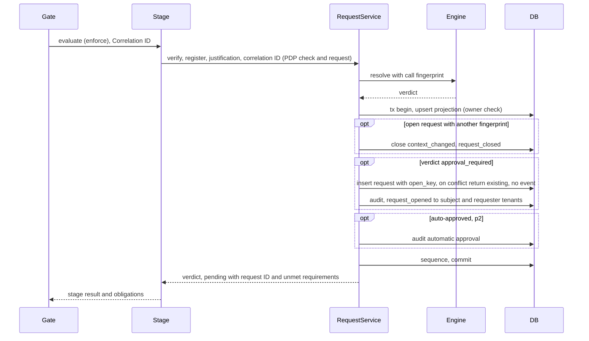

- `open_key` makes retries idempotent (`cpt-cf-approval-service-upreq-approval-request`).
- After a fingerprint change, bound approvals stop applying; `deny` and `not_required` still win, and `context_changed` appears only while approval is still required. An `invalid` verdict writes nothing.

#### Approver Records a Decision

- [ ] `p1` - **ID**: `cpt-cf-approval-service-seq-record-decision`

**Use cases**: `cpt-cf-approval-service-usecase-register-and-approve`, `cpt-cf-approval-service-usecase-repo-access`, `cpt-cf-approval-service-usecase-tenant-approval`, `cpt-cf-approval-service-usecase-policy-approval`

**Actors**: `cpt-cf-approval-service-actor-approver`, `cpt-cf-approval-service-actor-admin`, `cpt-cf-approval-service-actor-integrated-gear`

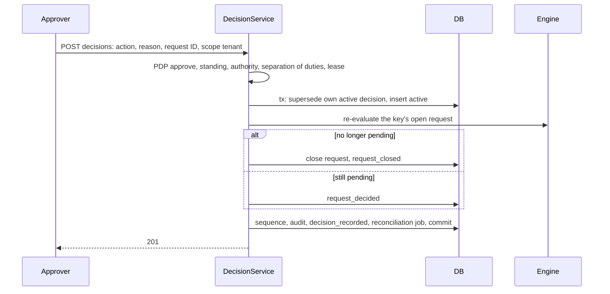

- Requests affected through tenant subjects (p1) or group subjects (p2) are reconciled after commit. Deny follows the same path.
- Bulk (`/decisions:bulk`): all items validated first, one transaction, `BULK_ITEMS_REJECTED` lists every failing item and records nothing; one audit record and `decision_recorded` per item.
- On behalf (p2): the gear needs `decide_on_behalf` and the named user `approve`; approver = named user, `recorded_by` = gear; revocation works the same way.

#### Multi-Approver Policy with Mandatory Approver

- [ ] `p1` - **ID**: `cpt-cf-approval-service-seq-multi-approver-policy`

**Use cases**: `cpt-cf-approval-service-usecase-policy-approval`, `cpt-cf-approval-service-usecase-admin-override`

**Actors**: `cpt-cf-approval-service-actor-approver`, `cpt-cf-approval-service-actor-integrated-gear`

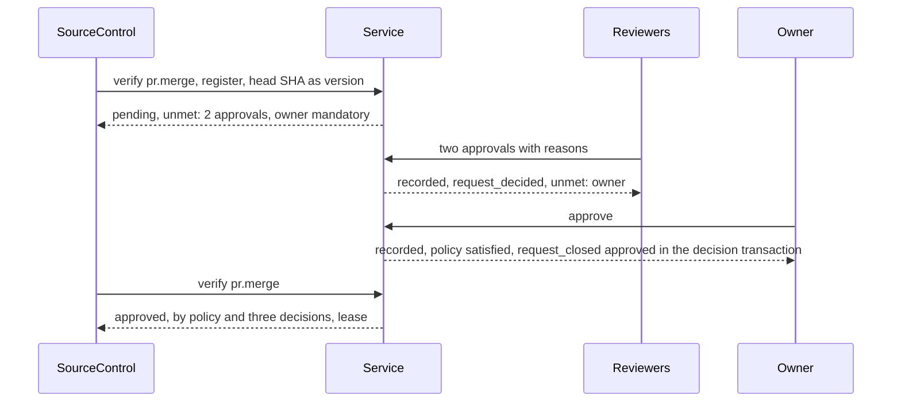

- A new SHA is a new projection; the author approving gets `SEPARATION_OF_DUTIES`.

#### Cross-Tenant Resolution and Owner-Only Authority

- [ ] `p1` - **ID**: `cpt-cf-approval-service-seq-hierarchy-resolution`

**Use cases**: `cpt-cf-approval-service-usecase-tenant-approval`

**Actors**: `cpt-cf-approval-service-actor-admin`, `cpt-cf-approval-service-actor-integrated-gear`, `cpt-cf-approval-service-actor-platform-vendor`

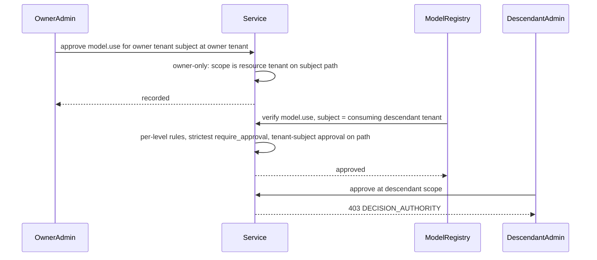

- A descendant deny at its own scope yields `denied` for that descendant and below.
- The rule may be a platform rule, an ancestor or tenant rule, or a default; deleting a tenant rule restores the remaining rules and defaults.

#### Governance Change and Request Reconciliation

- [ ] `p1` - **ID**: `cpt-cf-approval-service-seq-governance-reconciliation`

**Use cases**: `cpt-cf-approval-service-usecase-policy-approval`

**Actors**: `cpt-cf-approval-service-actor-admin`

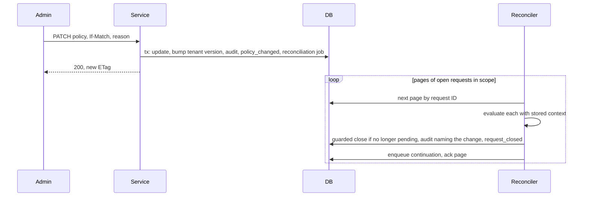

- Live policies: recorded approvals keep counting, so a relaxation closes requests as `approved`.
- The `status = open` guard closes each request at most once; the cursor makes jobs resumable.

#### Projection Deregistration and Request Withdrawal

- [ ] `p1` - **ID**: `cpt-cf-approval-service-seq-deregister-withdraw`

**Use cases**: `cpt-cf-approval-service-usecase-order-approval`, `cpt-cf-approval-service-usecase-task-wait`

**Actors**: `cpt-cf-approval-service-actor-integrated-gear`, `cpt-cf-approval-service-actor-requester`, `cpt-cf-approval-service-actor-admin`

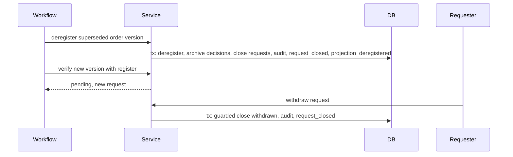

- Re-registering the identity creates a new row, so archived decisions never return (`cpt-cf-approval-service-upreq-gate-cancel`).

#### Request Event Wait and Outcome Read

- [ ] `p2` - **ID**: `cpt-cf-approval-service-seq-task-wait`

**Use cases**: `cpt-cf-approval-service-usecase-task-wait`, `cpt-cf-approval-service-usecase-register-and-approve`

**Actors**: `cpt-cf-approval-service-actor-integrated-gear`, `cpt-cf-approval-service-actor-approver`

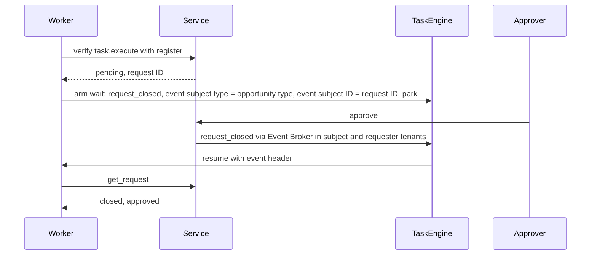

- On `context_changed` or `withdrawn` the worker verifies again and waits on the new request.

#### Auto-Approval

- [ ] `p2` - **ID**: `cpt-cf-approval-service-seq-auto-approval`

**Use cases**: `cpt-cf-approval-service-usecase-admin-override`

**Actors**: `cpt-cf-approval-service-actor-admin`, `cpt-cf-approval-service-actor-integrated-gear`

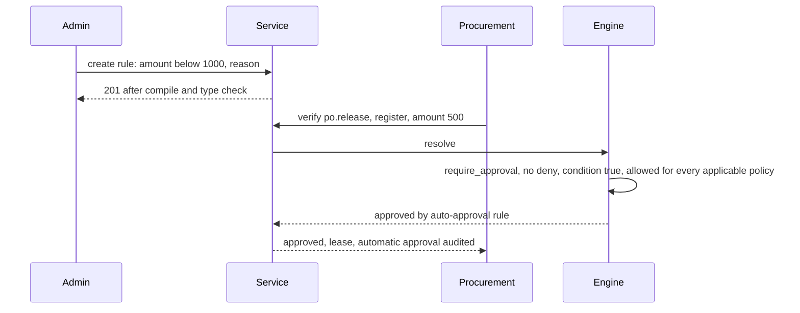

- Never overrides a deny; satisfies only policies at the rule's tenant or below; blocked by `forbid_auto_approval` or an ancestor `block_descendants` rule.

#### Staged Policy and Escalation

- [ ] `p2` - **ID**: `cpt-cf-approval-service-seq-staged-escalation`

**Use cases**: `cpt-cf-approval-service-usecase-order-approval`

**Actors**: `cpt-cf-approval-service-actor-integrated-gear`, `cpt-cf-approval-service-actor-approver`

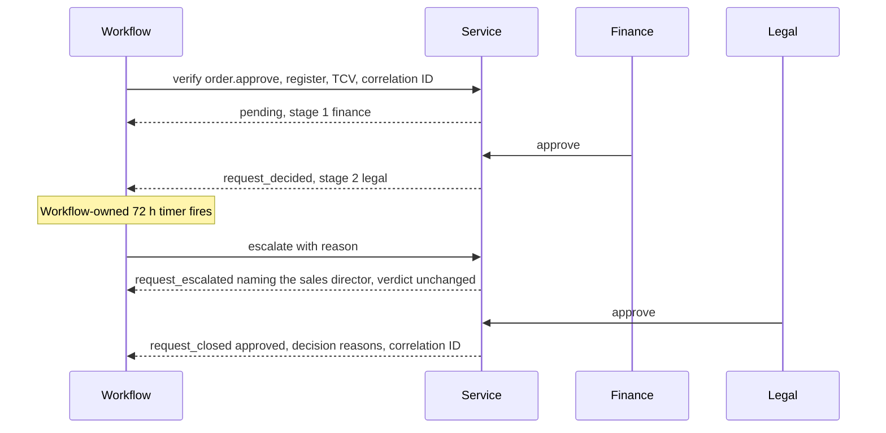

- An approval counts toward a stage only if recorded after the previous stage was satisfied; escalation grants nothing.

#### Group Approvers and Subject Group Decisions

- [ ] `p2` - **ID**: `cpt-cf-approval-service-seq-group-membership`

**Use cases**: `cpt-cf-approval-service-usecase-policy-approval`, `cpt-cf-approval-service-usecase-repo-access`

**Actors**: `cpt-cf-approval-service-actor-group-source`, `cpt-cf-approval-service-actor-approver`, `cpt-cf-approval-service-actor-integrated-gear`

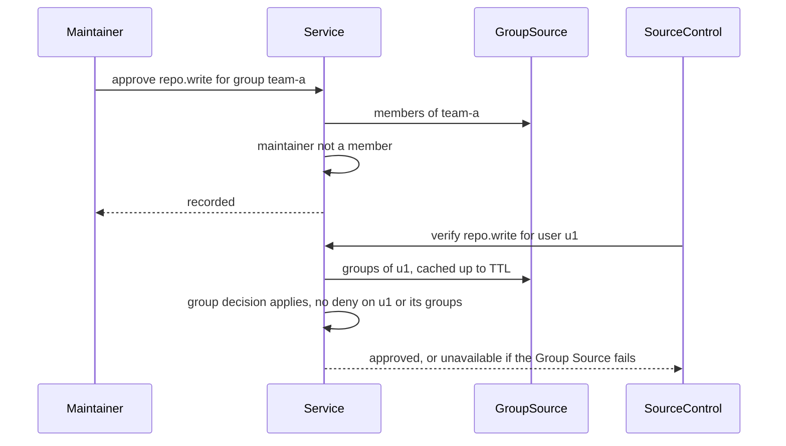

- A mandatory group is satisfied by one member's approval; `group_membership_cache_ttl_secs` bounds how long a removed member keeps a group approval.

### 3.7 Database schemas & tables

- [ ] `p1` - **ID**: `cpt-cf-approval-service-db-approval-store`

One gear-owned schema, prefix `apsv_`, migrated through `DatabaseCapability::migrations()`. Library-owned tables: `apsv_evt_outbox*` (Event Broker) and `apsv_job_outbox*` (reconciliation). Type references are UUIDs (`*_uuid`); timestamps are UTC `TIMESTAMP(3)`; no cross-table foreign keys (relationships in §3.1). Unless noted, every table also has `seq` BIGINT (change sequence of the last change) and `created_at`, `updated_at`; the three runtime governance tables also have `reason`, `created_by`, `updated_by`, and `row_version` (ETag).

#### Table: apsv_opportunity

- [ ] `p1` - **ID**: `cpt-cf-approval-service-dbtable-opportunity`

| Column | Type | Description |
|--------|------|-------------|
| `opportunity_uuid` | UUID | Registry reference |
| `type_id` | TEXT | Readable GTS identifier |
| `owner_subject_id` | VARCHAR(256) | First registrant |
| `display_name` | VARCHAR(256) | Display name |
| `default_action`, `standing_approvals`, `decision_authority` | SMALLINT | Trait snapshot |
| `accepted_projection_types`, `accepted_subject_types`, `context_schema` | JSON | Trait and schema snapshot |
| `registry_revision` | VARCHAR(128) | Registered revision |

- **PK**: `opportunity_uuid`. **Constraints**: NOT NULL throughout.
- **Additional info**: `unrestricted` catalog, fully cached; reads gated by `opportunity_read`.

#### Table: apsv_projection_type

- [ ] `p1` - **ID**: `cpt-cf-approval-service-dbtable-projection-type`

| Column | Type | Description |
|--------|------|-------------|
| `projection_type_uuid` | UUID | Registry reference |
| `type_id` | TEXT | Readable identifier |
| `owner_subject_id` | VARCHAR(256) | First registrant |

- **PK**: `projection_type_uuid`. **Constraints**: NOT NULL throughout.
- **Additional info**: `unrestricted`; ownership checks for projection writes.

#### Table: apsv_projection

- [ ] `p1` - **ID**: `cpt-cf-approval-service-dbtable-projection`

| Column | Type | Description |
|--------|------|-------------|
| `id` | UUID | UUIDv7 |
| `projection_type_uuid` | UUID | Type |
| `resource_tenant_id` | UUID | Tenant column |
| `resource_id` | VARCHAR(1024) | Resource ID |
| `version` | VARCHAR(256) | Empty when unversioned |
| `identity_hash` | BINARY(32) | SHA-256 of identity |
| `active_identity_hash` | BINARY(32) NULL | Set while active |
| `display_name` | VARCHAR(512) | Display name |
| `status` | SMALLINT | Active, deregistered |
| `registered_by` | VARCHAR(256) | Registering identity |
| `deregistered_at` | TIMESTAMP(3) NULL | Deregistration time |

- **PK**: `id`. **Constraints**: UNIQUE (`active_identity_hash`).
- **Additional info**: indexes (`identity_hash`), (`resource_tenant_id`, `projection_type_uuid`, `id`); `Scopable` on `resource_tenant_id`.

#### Table: apsv_rule

- [ ] `p1` - **ID**: `cpt-cf-approval-service-dbtable-rule`

| Column | Type | Description |
|--------|------|-------------|
| `id` | UUID | Rule ID |
| `scope_tenant_id` | UUID | Tenant column |
| `opportunity_pattern` | VARCHAR(1024) | GTS pattern |
| `projection_type_pattern`, `projection_id` | VARCHAR(1024) NULL, UUID NULL | Selector, exactly one |
| `subject_type_pattern` | VARCHAR(1024) NULL | p2 |
| `action` | SMALLINT | Deny, require, not required |
| `overridable` | BOOLEAN | p3, default false |

- **PK**: `id`. **Constraints**: one selector form (domain check).
- **Additional info**: index (`scope_tenant_id`); deletes remove the row, last state in audit.

#### Table: apsv_policy

- [ ] `p1` - **ID**: `cpt-cf-approval-service-dbtable-policy`

| Column | Type | Description |
|--------|------|-------------|
| `id` | UUID | Policy ID |
| `scope_tenant_id` | UUID | Tenant column |
| `opportunity_pattern`, selector, `subject_type_pattern` | as `apsv_rule` | Matching |
| `condition` | VARCHAR(4096) NULL | p2 CEL |
| `stages` | JSON | Minimum, mandatory approvers, approver list per stage |
| `max_lease_secs` | INTEGER NULL | Policy maximum lease |
| `forbid_auto_approval` | BOOLEAN | p2 |
| `escalation_recipients` | JSON NULL | p2 |
| `version` | INTEGER | Policy version (p2 snapshots) |

- **PK**: `id`. **Constraints**: one stage in p1, up to 8 in p2; `max_lease_secs` ≤ configured maximum.
- **Additional info**: index (`scope_tenant_id`).

#### Table: apsv_auto_approval_rule

- [ ] `p2` - **ID**: `cpt-cf-approval-service-dbtable-auto-approval-rule`

| Column | Type | Description |
|--------|------|-------------|
| `id` | UUID | Rule ID |
| `scope_tenant_id` | UUID | Tenant column |
| `opportunity_pattern`, selector, `subject_type_pattern` | as `apsv_rule` | Matching |
| `condition` | VARCHAR(4096) NULL | CEL; NULL matches always |
| `effect` | SMALLINT | Approve, block descendants |
| `enabled` | BOOLEAN | Enabled flag |

- **PK**: `id`. **Constraints**: one selector form.
- **Additional info**: index (`scope_tenant_id`).

#### Table: apsv_decision

- [ ] `p1` - **ID**: `cpt-cf-approval-service-dbtable-decision`

| Column | Type | Description |
|--------|------|-------------|
| `id` | UUID | UUIDv7 |
| `opportunity_uuid`, `projection_id` | UUID | Key |
| `subject_type_uuid`, `subject_type_id`, `subject_tenant_id`, `subject_id` | UUID, TEXT, UUID, VARCHAR(256) | Subject |
| `subject_key` | BINARY(32) | SHA-256 of subject |
| `scope_tenant_id` | UUID | Tenant column |
| `action` | SMALLINT | Approve, deny |
| `status` | SMALLINT | Lifecycle state |
| `approver_id`, `recorded_by` | VARCHAR(256), NULL | Approver; p2 on-behalf gear |
| `reason` | VARCHAR(2048) | Mandatory |
| `request_id`, `context_fingerprint` | UUID NULL, CHAR(64) NULL | Bound request |
| `lease_secs`, `expires_at` | INTEGER NULL, TIMESTAMP(3) NULL | Lease; p2 expiry |
| `active_key` | BINARY(32) NULL | Set while active |
| `supersedes_id`, `end_reason`, `ended_by`, `ended_at` | NULL | Transition data |

- **PK**: `id`. **Constraints**: UNIQUE (`active_key`) over opportunity, projection, subject, scope tenant, approver.
- **Additional info**: index (`opportunity_uuid`, `projection_id`, `subject_key`) serves the subject and all path tenant subjects in one `IN` lookup; (`scope_tenant_id`, `status`, `created_at`); (`status`, `expires_at`) for p2 expiry. `Scopable` on `scope_tenant_id`. No `updated_at`.

#### Table: apsv_request

- [ ] `p1` - **ID**: `cpt-cf-approval-service-dbtable-request`

| Column | Type | Description |
|--------|------|-------------|
| `id` | UUID | UUIDv7 |
| `opportunity_uuid`, `projection_id`, `projection_type_uuid`, `resource_tenant_id` | UUID | Key and PDP properties |
| `subject_type_uuid`, `subject_type_id`, `subject_id`, `subject_key` | as decision | Subject |
| `subject_tenant_id` | UUID | Tenant column |
| `requester_id`, `requester_tenant_id`, `opened_by` | VARCHAR(256), UUID, VARCHAR(256) | Requester and opening gear |
| `context`, `justification` | JSON NULL, VARCHAR(2048) NULL | Purged after retention |
| `context_fingerprint` | CHAR(64) | RFC 8785 SHA-256 of the opportunity type without its version and the binding attributes that this service's applicable conditions read or approvers see |
| `correlation_id` | VARCHAR(256) NULL | Caller correlation |
| `status`, `outcome`, `close_reason` | SMALLINT | Open or closed; settling outcome; close reason |
| `closed_by`, `closed_at` | NULL | Closing identity or cause |
| `escalation_level`, `policy_snapshot` | INTEGER, JSON NULL | p2 |
| `open_key` | BINARY(32) NULL | Set while open |

- **PK**: `id`. **Constraints**: UNIQUE (`open_key`) — the idempotency key of request opening.
- **Additional info**: indexes (`opportunity_uuid`, `status`, `id`) for reconciliation, (`subject_tenant_id`, `status`, `created_at`), (`requester_id`, `status`). `Scopable` on `subject_tenant_id`.

#### Table: apsv_audit_record

- [ ] `p1` - **ID**: `cpt-cf-approval-service-dbtable-audit-record`

| Column | Type | Description |
|--------|------|-------------|
| `id` | UUID | UUIDv7 |
| `scope_tenant_id` | UUID | Tenant column |
| `entity_kind`, `entity_id`, `opportunity_uuid` | SMALLINT, VARCHAR(1024), UUID NULL | Changed entity |
| `operation` | VARCHAR(64) | For example `superseded`, `closed`, `auto_approved` |
| `changed_by`, `changed_by_tenant_id`, `recorded_by` | NULL | NULL for service-caused changes |
| `reason`, `cause`, `correlation_id` | NULL | Reason; reconciliation cause |
| `previous_state`, `new_state` | JSON NULL | States |
| `occurred_at` | TIMESTAMP(3) | Commit time |

- **PK**: `id`. **Constraints**: insert and range read only; deletion only by retention purge.
- **Additional info**: indexes (`scope_tenant_id`, `occurred_at`), (`entity_kind`, `entity_id`, `occurred_at`), (`seq`). No `created_at`/`updated_at`.

#### Tables: apsv_governance_version and apsv_change_counter

- [ ] `p1` - **ID**: `cpt-cf-approval-service-dbtable-governance-version`

| Column | Type | Description |
|--------|------|-------------|
| `tenant_id` | UUID | Scope tenant; nil UUID = catalog and configuration |
| `version` | BIGINT | Sequence of the last governance change |
| `config_digest` | CHAR(64) NULL | Configuration digest (nil row) |

- **PK**: `tenant_id`. **Constraints**: NOT NULL except `config_digest`.
- **Additional info**: `unrestricted`; read as `tenant_id IN (path, nil)` per uncached call. No `seq`.

- [ ] `p1` - **ID**: `cpt-cf-approval-service-dbtable-change-counter`

| Column | Type | Description |
|--------|------|-------------|
| `id` | SMALLINT | Always 1 |
| `value` | BIGINT | Last change sequence |

- **PK**: `id`. **Constraints**: single row.
- **Additional info**: the row lock orders commits, so sequence order equals commit order; only writes take it.

#### Table: apsv_idempotency_key

- [ ] `p1` - **ID**: `cpt-cf-approval-service-dbtable-idempotency-key`

| Column | Type | Description |
|--------|------|-------------|
| `subject_key` | BINARY(32) | SHA-256 of caller and tenant |
| `idempotency_key`, `operation` | VARCHAR(128), VARCHAR(64) | Client key, operation |
| `request_hash`, `response` | BINARY(32), JSON | Body fingerprint, stored 2xx |
| `tenant_id` | UUID | Tenant column |
| `expires_at` | TIMESTAMP(3) | Expiry |

- **PK**: (`subject_key`, `idempotency_key`, `operation`). **Constraints**: NOT NULL throughout.
- **Additional info**: index (`expires_at`). No `seq`.

#### Tables: apsv_recertification_campaign and apsv_recertification_item

- [ ] `p3` - **ID**: `cpt-cf-approval-service-dbtable-recertification-campaign`

| Column | Type | Description |
|--------|------|-------------|
| `id` | UUID | Campaign ID |
| `scope_tenant_id` | UUID | Tenant column |
| `opportunity_pattern` | VARCHAR(1024) | Scope |
| `reviewers` | JSON | Reviewer users |
| `deadline`, `status`, `created_by` | TIMESTAMP(3), SMALLINT, VARCHAR(256) | Lifecycle |

- **PK**: `id`. **Constraints**: NOT NULL throughout.
- **Additional info**: index (`scope_tenant_id`, `status`).

- [ ] `p3` - **ID**: `cpt-cf-approval-service-dbtable-recertification-item`

| Column | Type | Description |
|--------|------|-------------|
| `id`, `campaign_id`, `decision_id` | UUID | Item, campaign, approve decision |
| `scope_tenant_id` | UUID | Tenant column |
| `result`, `reviewed_by`, `reviewed_at` | NULL | Confirmed or revoked |

- **PK**: `id`. **Constraints**: UNIQUE (`campaign_id`, `decision_id`).
- **Additional info**: a revoke uses the normal revocation path.

### 3.8 Deployment Topology

- [ ] `p1` - **ID**: `cpt-cf-approval-service-topology-replicated-gear`

In-process with the governance gate in the Embedded profile; its own replicated unit in the Self-Hosted and Kubernetes Native profiles, reached by `admission-control` over the stage contract's REST or gRPC projection ([Operation Governance DESIGN §3.8](../../../docs/arch/operation-governance/DESIGN.md#38-deployment-topology)). Any number of replicas run on one database. Replicas share no memory: snapshots are revalidated per call and background work is claimed by lease or advisory lock, so no leader election is needed. `deps = ["types-registry", "authz-resolver", "tenant-resolver", "event-broker"]`; Resource Group is added in p2.

## 4. Additional context

### 4.1 Configuration and Benchmark Profile

| Key | Default | Purpose |
|-----|---------|---------|
| `default_lease_secs` | 60 (proposed; PRD §13 open) | Default approval lease |
| `max_lease_secs` | 900 (proposed; PRD §13 open) | Maximum lease for decisions and policies |
| `reconciliation_bound_secs` | 60 (proposed; PRD §13 open) | Reconciliation delay bound |
| `audit_retention_days` | 400 (proposed; PRD silent) | Audit and request-data retention |
| `batch_verify_max_items`, `bulk_decision_max_items`, `projection_batch_max_items` | 100 each | List limits |
| `reconciliation_page_size` | 500 | Requests per page |
| `tenant_subject_types` | `["gts.cf.core.am.tenant.v1~"]` | Tenant subject types |
| `context_max_bytes` | 4096 | Context size per call |
| `condition_cost_budget` | 10,000 | CEL budget (p2) |
| `tenant_ancestry_cache_ttl_secs`, `group_membership_cache_ttl_secs` | 30 each | Adapter caches |
| `governance_cache_max_tenants` | 50,000 | Snapshot bound |
| `idempotency_retention_hours` | 24 | Idempotency keys |
| `rules`, `defaults`, `policies` | empty | Platform rules (bind every tenant), platform defaults, configuration policies |
| `event_producer.credentials` | secret reference | Publishing subject credentials |

The availability target (PRD §13) is not set here.

**Benchmark profile** (defines "nominal load" and "average machine" for `cpt-cf-approval-service-nfr-latency` and `cpt-cf-approval-service-nfr-throughput`): service 4 vCPU, 8 GiB; database 8 vCPU, 32 GiB, NVMe, sub-millisecond round trip; 1,000,000 decisions over 10,000 tenants, depth up to 5; 1,000 runtime rules and policies; 100 opportunities; 8 clients at 1,000 calls/s without SDK cache, 10% with register; once per database.

### 4.2 Quality Attributes

- **Security**: tenant isolation through `AccessScope` on every query. Request row rule: readable by the requester, the opening gear, `approve` holders, and administrators of the scope; `context` and `justification` are returned only to the requester, `approve` holders, and administrators — never to the opening gear, other request readers, or audit readers without `approve` or `administer`. The publishing identity has only the grants in §3.3. The service stores no secrets.
- **Input hardening**: bounded identifier lengths, list sizes, context size, CEL cost; ASCII identifier patterns.
- **Fault tolerance**: verification fails closed; write paths change nothing on pre-commit failures (`DEPENDENCY_UNAVAILABLE`); broker outages do not block changes; dead letters are replayed after the grant is fixed; reconciliation resumes from its cursor.
- **Observability**: `apsv_verify_duration_seconds{outcome,register}`, `apsv_verdicts_total{outcome,reason_code}`, `apsv_reconciliation_lag_seconds`, `apsv_requests_closed_total{close_reason}`, `apsv_outbox_dead_letters_total` (pages), `apsv_governance_cache_tenants`, `apsv_opportunity_drift_total`, `apsv_dependency_errors_total{dependency}`. Logs and traces never include context values or justifications.
- **Testability**: table-driven Verdict Engine tests per PRD acceptance criterion; `open_key`/`active_key` race tests on PostgreSQL, MariaDB, SQLite; fault injection per transaction step; e2e under `testing/e2e/`, including a Task Engine wait.
- **Compliance**: audit trail, access review (p2), and campaigns (p3) cover the SOX, ISO 27001, and SOC 2 needs named in the PRD.

### 4.3 Deviations, Assumptions, and PRD Notes

- **Deviation (API guideline §6)**: governance deletes use `POST …/{id}:delete` because every runtime change needs a reason and DELETE bodies are not portable. Review owner: Approval Service owner.
- **Deviation (PRD §10 "platform audit infrastructure")**: no audit gear exists, and `cpt-cf-approval-service-nfr-atomicity` needs the audit record in the change transaction, so audit is a local append-only table; a forwarder can ship it later. Review owner: Approval Service owner.
- **PRD inconsistency**: §4.2 puts "delegation and proxy approvals" out of scope, while `cpt-cf-approval-service-fr-on-behalf-decision` (p2) is in scope; the design records only the named approver's own decision.
- **PRD inconsistency**: `cpt-cf-approval-service-fr-audit-trail` audits "every automatic approval", while verification without register must be read-only; the design audits automatic approvals only with the register option, as `cpt-cf-approval-service-fr-auto-approval` states.
- **PRD inconsistency**: `cpt-cf-approval-service-fr-create-request` lets the opening gear read a request, while `cpt-cf-approval-service-nfr-data-classification` excludes it from context readers; the design redacts context and justification for the gear.
- **PRD inconsistency**: `cpt-cf-approval-service-fr-request-escalation` lists the administrator as actor, but its text allows only the requester and the opening gear; the design follows the text.
- **PRD vs UPSTREAM priority**: the PRD makes bulk decisions, audit, request read, and request events p1, although UPSTREAM asks for them at p2; the design follows the PRD.
- **Assumptions**: tenant subjects are identified by `tenant_subject_types`; the PDP evaluates `approve` per projection (PRD §11); the single change counter row is not a write bottleneck (fallback: per-tenant sequences).
- **Note**: p2 expiry changes a verdict without a commit; `verdict_version` advances when the expiry transition commits, and leases never extend past an expiry.

### 4.4 ADR Candidates

CEL as condition language (`cpt-cf-approval-service-tech-cel-conditions`); single global change sequence as verdict version; first-claim type ownership; per-tenant governance snapshot with per-call version check; local append-only audit table; `POST …:delete` for governance deletes.

## 5. Traceability

- **PRD**: [PRD.md](./PRD.md); **UPSTREAM_REQS**: [UPSTREAM_REQS.md](./UPSTREAM_REQS.md)
- **ADRs**: see Key ADRs (§1.2); **Features**: none yet
- **GTS**: [schemas/schemas/](../schemas/schemas/), [schemas/instances/](../schemas/instances/)

| PRD use case | Sequences |
|--------------|-----------|
| `cpt-cf-approval-service-usecase-register-and-approve` | `cpt-cf-approval-service-seq-type-registration`, `cpt-cf-approval-service-seq-verify-read-only`, `cpt-cf-approval-service-seq-verify-register`, `cpt-cf-approval-service-seq-record-decision`, `cpt-cf-approval-service-seq-task-wait` |
| `cpt-cf-approval-service-usecase-admin-override` | `cpt-cf-approval-service-seq-type-registration`, `cpt-cf-approval-service-seq-verify-register`, `cpt-cf-approval-service-seq-multi-approver-policy`, `cpt-cf-approval-service-seq-auto-approval` |
| `cpt-cf-approval-service-usecase-policy-approval` | `cpt-cf-approval-service-seq-verify-register`, `cpt-cf-approval-service-seq-record-decision`, `cpt-cf-approval-service-seq-multi-approver-policy`, `cpt-cf-approval-service-seq-governance-reconciliation`, `cpt-cf-approval-service-seq-group-membership` |
| `cpt-cf-approval-service-usecase-tenant-approval` | `cpt-cf-approval-service-seq-verify-read-only`, `cpt-cf-approval-service-seq-record-decision`, `cpt-cf-approval-service-seq-hierarchy-resolution` |
| `cpt-cf-approval-service-usecase-repo-access` | `cpt-cf-approval-service-seq-verify-read-only`, `cpt-cf-approval-service-seq-verify-register`, `cpt-cf-approval-service-seq-record-decision`, `cpt-cf-approval-service-seq-group-membership` |
| `cpt-cf-approval-service-usecase-task-wait` | `cpt-cf-approval-service-seq-verify-register`, `cpt-cf-approval-service-seq-task-wait`, `cpt-cf-approval-service-seq-deregister-withdraw` |
| `cpt-cf-approval-service-usecase-order-approval` | `cpt-cf-approval-service-seq-staged-escalation`, `cpt-cf-approval-service-seq-deregister-withdraw` |

**Interfaces and contracts**: `cpt-cf-approval-service-interface-rest-api` → `cpt-cf-approval-service-interface-rest-endpoints`; `cpt-cf-approval-service-interface-sdk` → `cpt-cf-approval-service-interface-sdk-client`; `cpt-cf-approval-service-contract-verification` → verdict type; `cpt-cf-approval-service-contract-events` → `cpt-cf-approval-service-interface-change-events`; `cpt-cf-approval-service-contract-group-source` → `cpt-cf-approval-service-component-directory-adapter`.

| Upstream requirement | Design elements |
|----------------------|-----------------|
| `cpt-cf-approval-service-upreq-register-resource` | `cpt-cf-approval-service-component-registration-service`, `cpt-cf-approval-service-seq-type-registration` |
| `cpt-cf-approval-service-upreq-query-status` | `cpt-cf-approval-service-component-verdict-engine`, `cpt-cf-approval-service-seq-verify-read-only` |
| `cpt-cf-approval-service-upreq-batch-status` | `cpt-cf-approval-service-seq-verify-read-only` (batch) |
| `cpt-cf-approval-service-upreq-status-changed-event` | `cpt-cf-approval-service-interface-change-events`, lease-bounded cache in the Governance Enforcer and SDK |
| `cpt-cf-approval-service-upreq-bulk-approve` | `cpt-cf-approval-service-seq-record-decision` (bulk) |
| `cpt-cf-approval-service-upreq-auto-approval` | `cpt-cf-approval-service-entity-auto-approval-rule`, `cpt-cf-approval-service-seq-auto-approval` |
| `cpt-cf-approval-service-upreq-tenant-hierarchy` | `cpt-cf-approval-service-seq-hierarchy-resolution` |
| `cpt-cf-approval-service-upreq-lifecycle` | Decision and request lifecycles (§3.1) |
| `cpt-cf-approval-service-upreq-on-behalf-decision` | `cpt-cf-approval-service-seq-record-decision` (on behalf) |
| `cpt-cf-approval-service-upreq-audit-trail` | `cpt-cf-approval-service-dbtable-audit-record`, `cpt-cf-approval-service-component-change-recorder` |
| `cpt-cf-approval-service-upreq-stakeholder-notifications` | Request events; delivery excluded by `cpt-cf-approval-service-constraint-no-execution` |
| `cpt-cf-approval-service-upreq-request-event-wait` | `cpt-cf-approval-service-seq-task-wait` |
| `cpt-cf-approval-service-upreq-request-read` | `GET /requests/{request_id}`, SDK `get_request` |
| `cpt-cf-approval-service-upreq-requirement-verdict` | Versioned projection, `verdict_version`, fail-closed `unavailable` |
| `cpt-cf-approval-service-upreq-approval-request` | `cpt-cf-approval-service-seq-verify-register` |
| `cpt-cf-approval-service-upreq-decision-outcome` | `request_closed` with outcome, decisions, reasons, correlation ID |
| `cpt-cf-approval-service-upreq-gate-cancel` | `cpt-cf-approval-service-seq-deregister-withdraw` |
| `cpt-cf-approval-service-upreq-multi-party-gates` | `cpt-cf-approval-service-seq-multi-approver-policy` |
| `cpt-cf-approval-service-upreq-staged-gates` | `cpt-cf-approval-service-seq-staged-escalation` |
| `cpt-cf-approval-service-upreq-threshold-evaluation` | `cpt-cf-approval-service-tech-cel-conditions` |
| `cpt-cf-approval-service-upreq-escalation` | `cpt-cf-approval-service-seq-staged-escalation` |
| `cpt-cf-approval-service-upreq-bss-library-parity` | Future scope (PRD §4.3); not designed |
