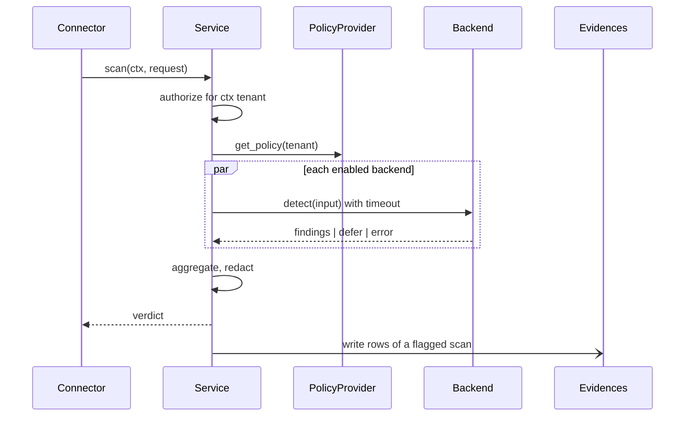
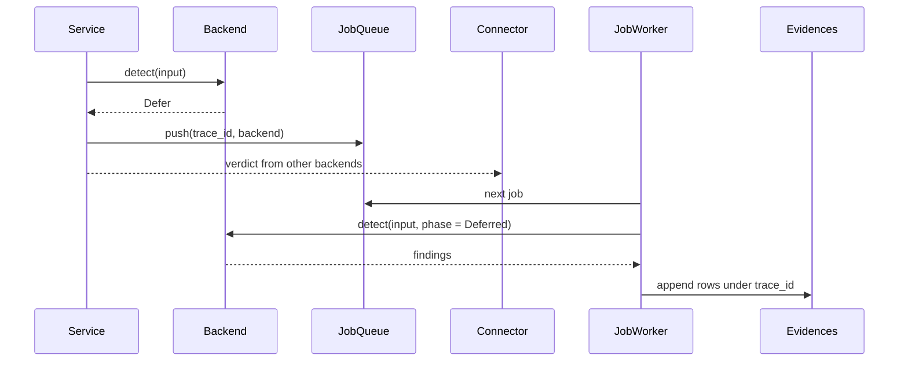
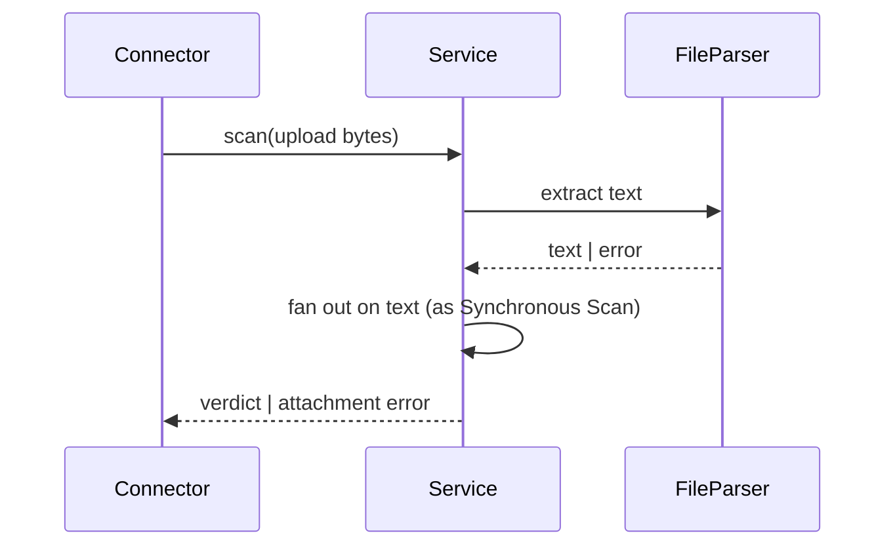
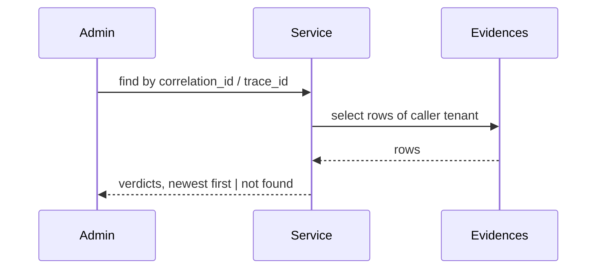

# Technical Design — prompt-scanner

- [ ] `p3` - **ID**: `cpt-cf-prompt-scanner-design-main`

<!-- toc -->

- [1. Architecture Overview](#1-architecture-overview)
  - [1.1 Architectural Vision](#11-architectural-vision)
  - [1.2 Architecture Drivers](#12-architecture-drivers)
  - [1.3 Architecture Layers](#13-architecture-layers)
- [2. Principles & Constraints](#2-principles--constraints)
  - [2.1 Design Principles](#21-design-principles)
  - [2.2 Constraints](#22-constraints)
- [3. Technical Architecture](#3-technical-architecture)
  - [3.1 Domain Model](#31-domain-model)
  - [3.2 Component Model](#32-component-model)
  - [3.3 API Contracts](#33-api-contracts)
  - [3.4 Internal Dependencies](#34-internal-dependencies)
  - [3.5 External Dependencies](#35-external-dependencies)
  - [3.6 Interactions & Sequences](#36-interactions--sequences)
  - [3.7 Database schemas & tables](#37-database-schemas--tables)
- [4. Additional context](#4-additional-context)
  - [Storage](#storage)
  - [Async deferral for oversized inputs](#async-deferral-for-oversized-inputs)
  - [Degraded coverage](#degraded-coverage)
  - [Fail mode](#fail-mode)
  - [Planned `llm-gateway` integration](#planned-llm-gateway-integration)
  - [Deployment shape](#deployment-shape)
- [5. Traceability](#5-traceability)

<!-- /toc -->

## 1. Architecture Overview

### 1.1 Architectural Vision

`prompt-scanner` is the tenant-aware inspection service behind the consumers of the GenAI
Security program. Connectors (endpoint agents, first-party AI features, customer apps,
AI/API gateways, MCP proxies, network connectors) submit prompts, responses, uploads and
MCP traffic; the gear runs a pluggable detector portfolio and returns one standardized,
traceable verdict: `allow`, `audit`, `warn`, `redact` or `block`.

The gear decides; the consumer enforces. It never captures, forwards or proxies traffic.
Detection lives in scanner backend plugins discovered through `types-registry`; the gear
owns everything that must not be repeated per detector: tenant policy resolution, the
concurrent fan-out, per-backend timeouts, aggregation, redaction, attachment text
extraction and the evidence store. Tenant policy comes from a pluggable policy provider;
the gear stores no policies of its own.

The shipped detectors are plugins under `plugins/`: `regex-scanner` (deterministic
patterns and checksums), `onnx-scanner` (ML PII detection on in-process ONNX models; see
its [runtime design](../plugins/onnx-scanner/docs/runtime/DESIGN.md)) and
`always-allow-plugin` (a test double).

### 1.2 Architecture Drivers

#### Functional Drivers

| Requirement | Design Response |
|-------------|------------------|
| `cpt-cf-prompt-scanner-fr-sync-scan` | `POST /scans` and `PromptScannerClientV1::scan` call the scan orchestrator, which returns the aggregated verdict with a fresh `trace_id` |
| `cpt-cf-prompt-scanner-fr-caller-tenant` | Tenant taken from `SecurityContext::subject_tenant_id` (a tenantless token is refused); PDP check through `authz-resolver` (`prompt_scanner.scan_record`, `create`) before any backend runs; the request type has no tenant field |
| `cpt-cf-prompt-scanner-fr-attachment-scan` | The orchestrator calls `file-parser` for `ScanContent::File` before the fan-out, under `attachment_parse_timeout`; an extraction failure or extracted text over 4 MiB is an error, never an empty payload |
| `cpt-cf-prompt-scanner-fr-deferred-scan` | `scan_async` and `BackendOutcome::Defer` share one bounded in-memory job queue (`job_queue_capacity`; full ⇒ `Overloaded`) drained by the background worker (`jobs_per_tick` per `job_poll_interval`); job status is readable via `get_job_status` / `GET /scans/async/{job_id}` for `job_status_ttl`; the background call marks the input `ScanPhase::Deferred` so the backend scans it in full; deferred findings are appended under the original `trace_id` |
| `cpt-cf-prompt-scanner-fr-backend-fanout` | Backends listed from `types-registry`, filtered by `enabled_backends`, resolved through scoped `ClientHub` entries and called concurrently, each under `backend_timeout` |
| `cpt-cf-prompt-scanner-fr-no-silent-clean` | A required backend that errors (`503`), times out (`504`) or is missing fails the scan. Any other backend that errors, times out, is missing or deferred is listed in `ScanVerdict::unscored_backends` with a stable reason (`timeout`, `unavailable`, `error`, `deferred`), logged at `warn` and counted (`prompt_scanner_unscored_backends`); it never changes the verdict action. A backend confidence outside `[0, 1]` counts as `1.0` |
| `cpt-cf-prompt-scanner-fr-verdict-aggregation` | Pure aggregation function in the domain: content-kind gate, per-category thresholds, action overrides keyed by whole dot segments (most specific wins), maximum action, `default_action` |
| `cpt-cf-prompt-scanner-fr-redaction` | SDK redaction helper replaces the spans of redact-suggesting findings, merging overlaps; a span-less one blanks the whole text |
| `cpt-cf-prompt-scanner-fr-policy-provider` | Policy resolution picks the lowest-`priority`-value `PolicyProviderSpecV1` instance, else the built-in read-only provider serving `fallback_policy`. When resolution fails, `fail_mode: closed` (default) refuses with `PolicyUnavailable`; `open` warns and falls back. Policy reads and writes are authorized on `prompt_scanner.tenant_policy` (`get` / `update`); a read-only provider answers `Unsupported` (`501`) |
| `cpt-cf-prompt-scanner-fr-evidence-storage` | After the verdict returns, one `evidences` row per finding of a flagged scan is written in the background; clean scans write nothing |
| `cpt-cf-prompt-scanner-fr-evidence-lookup` | `GET /scans/{trace_id}` and `GET /scans?correlation_id=` read the caller's tenant only, authorized on `prompt_scanner.scan_record` (`get`) with a PDP tenant constraint; there is no listing endpoint |
| `cpt-cf-prompt-scanner-fr-evidence-delete` | `DELETE /scans/{trace_id}` hard-deletes the scan's rows in the caller's tenant, authorized on `prompt_scanner.scan_record` (`delete`) |
| `cpt-cf-prompt-scanner-fr-backend-extension` | Fan-out is driven only by registered `ScannerBackendSpecV1` instances and the tenant policy; no backend is known at compile time |
| `cpt-cf-prompt-scanner-fr-backend-listing` | `GET /backends`, authorized on `prompt_scanner.backend` (`list`), lists registered instances and whether each has a resolvable `ClientHub` entry |

#### NFR Allocation

| NFR ID | NFR Summary | Allocated To | Design Response | Verification Approach |
|--------|-------------|--------------|-----------------|----------------------|
| `cpt-cf-prompt-scanner-nfr-no-raw-content` | No payload in telemetry | SDK models, scan orchestrator, metrics port | `Debug` of request and input types prints lengths only; metrics are counts and labels | Unit tests on `Debug` output; review |
| `cpt-cf-prompt-scanner-nfr-backend-timeout` | Bounded backend latency | Scan orchestrator | Concurrent calls, each wrapped in `backend_timeout` (default 5 s, at most 5 min) | Service tests with a slow fake backend |
| `cpt-cf-prompt-scanner-nfr-tenant-isolation` | No cross-tenant evidence reads | Evidence store | Every read and delete is scoped to the caller's tenant; not-found cases are not told apart | Service and repository tests |
| `cpt-cf-prompt-scanner-nfr-evidence-retention` | Bounded retention | Evidence store, retention job | `expires_at` set at write, clamped to `max_retention` / `max_evidence_retention`; periodic batched delete | Repository tests; retention metrics |
| `cpt-cf-prompt-scanner-nfr-bounded-queues` | Bounded queues | Scan orchestrator, job worker, evidence writer | Bounded `mpsc` channels (`job_queue_capacity`, `evidence.write_queue_capacity`); job statuses evicted after `job_status_ttl`; capacities validated at init | Service tests; queue-full metrics |
| `cpt-cf-prompt-scanner-nfr-evidence-write-isolation` | Storage never holds the verdict | Scan orchestrator, evidence writer | Rows handed to a bounded queue (`evidence.write_queue_capacity`) drained by one writer task, each insert under `evidence.write_timeout`; a full queue or failed write is counted, not raised | Service tests; `evidence_write_failed` metric |

#### Key ADRs

No ADRs yet. The decisions that shape this gear are recorded as principles and
constraints in §2 and in §4.

### 1.3 Architecture Layers

- [ ] `p3` - **ID**: `cpt-cf-prompt-scanner-tech-layers`

```text
REST (api/rest)  ──┐
                   ├──▶ Service (domain) ──▶ PolicyProvider (plugin or built-in)
ClientHub client ──┘          │        ──▶ ScannerBackendClient × N (plugins, concurrent)
(local_client)                │        ──▶ file-parser (uploads)
                              ▼
                     evidences store (infra/storage, SecureORM)
```

| Layer | Responsibility | Technology |
|-------|---------------|------------|
| Presentation | REST routes, DTOs, error mapping | `OperationBuilder`, axum |
| Application | `PromptScannerClientV1` local client | `ClientHub` |
| Domain | Scan orchestration, policy resolution, aggregation, evidence rows, job queue | Rust, `tokio` |
| Infrastructure | `evidences` table, migrations, metrics meter | SeaORM / SecureORM, OpenTelemetry |

## 2. Principles & Constraints

### 2.1 Design Principles

#### Fan-out, Not Pick-one

- [ ] `p1` - **ID**: `cpt-cf-prompt-scanner-principle-fan-out`

Most plugin extension points in the platform select one instance by vendor and priority
(`choose_plugin_instance`). Detectors are independent voters, so the gear calls every
backend the tenant enables, concurrently, and aggregates. Policy providers are the
opposite case — exactly one is authoritative — and use single selection.

#### The Platform Decides, the Consumer Enforces

- [ ] `p1` - **ID**: `cpt-cf-prompt-scanner-principle-consumer-enforces`

No capture, forwarding, TLS termination or credential handling in this gear. Consumers
apply the verdict.

#### No Silent Clean

- [ ] `p1` - **ID**: `cpt-cf-prompt-scanner-principle-no-silent-clean`

A scan that skipped a required backend fails. A scan that went without an optional
backend says so in `unscored_backends`, so degraded coverage never looks clean. A policy that cannot be resolved fails the
request by default (`fail_mode: closed`). A confidence that is not a number in `[0, 1]`
counts as certain. An empty `enabled_backends` list means no detection by explicit
configuration, not by accident.

#### No Raw Content Outside the Request

- [ ] `p1` - **ID**: `cpt-cf-prompt-scanner-principle-no-raw-content`

Payloads never reach logs, metrics or errors. The evidence store keeps findings, and an
excerpt only when the tenant's evidence policy asks for one.

### 2.2 Constraints

#### Plugin Isolation

- [ ] `p1` - **ID**: `cpt-cf-prompt-scanner-constraint-plugin-isolation`

Regular gears cannot depend on plugin gears. `prompt-scanner` depends on no backend or
policy-provider crate; it discovers them through `types-registry` and calls them through
scoped `ClientHub` entries.

#### No Stored Tenant Policy

- [ ] `p1` - **ID**: `cpt-cf-prompt-scanner-constraint-no-policy-storage`

Tenant policy belongs to the policy provider. Without a provider plugin, the built-in
provider serves one policy from configuration (`fallback_policy`) to every tenant and
refuses writes.

#### Lookup, Not Listing

- [ ] `p1` - **ID**: `cpt-cf-prompt-scanner-constraint-no-listing`

Stored scans are found by `trace_id` or by `correlation_id` only. There is no endpoint
that lists or searches a tenant's stored scans.

## 3. Technical Architecture

### 3.1 Domain Model

**Technology**: Rust structs in `prompt-scanner-sdk`, GTS types for plugin specs
**Location**: [`prompt-scanner-sdk/src/`](../prompt-scanner-sdk/src/)

- [ ] `p2` - **ID**: `cpt-cf-prompt-scanner-entity-scan`

| Entity | Description |
|--------|-------------|
| `ScanRequest` | `connector_id`, optional `correlation_id`, `content_kind`, the content (text or a file), free-form metadata. Names no tenant. |
| `ScanVerdict` | `trace_id`, `tenant_id`, `action`, `findings`, `redacted_payload` (synchronous `redact` only), `unscored_backends` (synchronous only: backends that did not contribute, each with a reason `timeout`, `unavailable`, `error` or `deferred`), `created_at`. |
| `Detection` | What a backend returns: `category`, `severity`, `confidence`, optional `span`, `suggested_action`. |
| `Finding` | A `Detection` stamped by the gear with the backend's identity and version: `category`, `severity`, `confidence`, optional byte `span`, `suggested_action`. |
| `VerdictAction` | `Allow < Audit < Warn < Redact < Block`; aggregation takes the maximum. |
| `ContentKind` | `prompt`, `response`, `upload`, `mcp_tool_call`, `mcp_tool_result`. |
| `TenantPolicy` | `enabled_backends`, `required_backends`, `thresholds`, `default_action`, `category_action_overrides`, `content_kinds`, `retention`, `evidence`. |
| `ScanJobHandle` / `ScanJobStatus` | `job_id`, `trace_id` and status of a queued scan: `Queued`, `Running`, `Completed { trace_id }`, `Failed { code }`. |

**Relationships**:
- `ScanRequest` → `ScanVerdict`: one verdict per request, keyed by `trace_id`.
- `ScanVerdict` → `Finding`: zero or more; a verdict with findings is a flagged scan.
- `TenantPolicy` → backends: `enabled_backends` names backend vendors.

### 3.2 Component Model

```text
api/rest ──▶ Service ──▶ policy resolution ──▶ PolicyProvider
                │
                ├──▶ backend fan-out ──▶ ScannerBackendClient (each enabled instance)
                ├──▶ aggregation + redaction
                ├──▶ job queue ◀── background worker
                └──▶ evidence writer ──▶ evidences ◀── retention job
```

#### REST API

- [ ] `p1` - **ID**: `cpt-cf-prompt-scanner-component-rest-api`

##### Why this component exists

Exposes the gear to connectors and administrators that are not in the same process.

##### Responsibility scope

Routes under `/prompt-scanner/v1`, request validation into SDK types, error mapping to
canonical error bodies.

##### Responsibility boundaries

No business logic; every handler calls the domain service.

##### Related components (by ID)

- `cpt-cf-prompt-scanner-component-scan-service` — calls

#### Scan Service

- [ ] `p1` - **ID**: `cpt-cf-prompt-scanner-component-scan-service`

##### Why this component exists

The one place that turns a request into a verdict.

##### Responsibility scope

Authorization, policy resolution, attachment extraction, backend resolution and
concurrent fan-out with timeouts, aggregation, redaction, scheduling evidence writes,
evidence lookup and removal, and the backend listing.

##### Responsibility boundaries

Does not detect anything itself and does not store tenant policy.

##### Related components (by ID)

- `cpt-cf-prompt-scanner-component-policy-resolution` — calls
- `cpt-cf-prompt-scanner-component-job-worker` — enqueues to
- `cpt-cf-prompt-scanner-component-evidence-store` — writes to and reads from

#### Policy Resolution

- [ ] `p1` - **ID**: `cpt-cf-prompt-scanner-component-policy-resolution`

##### Why this component exists

Tenant policy must come from one authoritative source that can be replaced without
touching the service.

##### Responsibility scope

Lists `PolicyProviderSpecV1` instances, picks the lowest `priority` value, resolves its
scoped client, and otherwise falls back to the built-in provider that serves
`fallback_policy` (or `None`, meaning the permissive default for the tenant).

##### Responsibility boundaries

Does not persist policy and does not merge policies from several providers.

##### Related components (by ID)

- `cpt-cf-prompt-scanner-component-scan-service` — called by

#### Job Worker

- [ ] `p2` - **ID**: `cpt-cf-prompt-scanner-component-job-worker`

##### Why this component exists

Asynchronous scans and deferred backends must not hold the synchronous path.

##### Responsibility scope

Drains the bounded in-memory job queue, at most `jobs_per_tick` jobs every
`job_poll_interval`; runs queued scans and deferred backend calls (under
`deferred_backend_timeout`); keeps each job's status for `job_status_ttl`; re-aggregates and appends new findings under the original
`trace_id`.

##### Responsibility boundaries

No durability: queued work is lost on restart.

##### Related components (by ID)

- `cpt-cf-prompt-scanner-component-scan-service` — fed by
- `cpt-cf-prompt-scanner-component-evidence-store` — writes to

#### Evidence Store

- [ ] `p1` - **ID**: `cpt-cf-prompt-scanner-component-evidence-store`

##### Why this component exists

The audit trail of flagged scans.

##### Responsibility scope

One row per finding of a flagged scan, with expiry and optional excerpt; reads by
`trace_id` and `correlation_id`; hard delete; a periodic retention job deletes expired
rows in batches. Rows are never updated; a scan's verdict on read is the highest `action`
across its rows.

##### Responsibility boundaries

Never stores clean scans, payloads or tenant policy.

##### Related components (by ID)

- `cpt-cf-prompt-scanner-component-scan-service` — owned data for

### 3.3 API Contracts

- **Interfaces (PRD)**: `cpt-cf-prompt-scanner-interface-rest-api`, `cpt-cf-prompt-scanner-interface-client-v1`
- **Contracts**: `cpt-cf-prompt-scanner-contract-plugin-registration`
- **Technology**: REST/OpenAPI; Rust trait over `ClientHub`
- **Location**: [`prompt-scanner/src/api/rest/routes.rs`](../prompt-scanner/src/api/rest/routes.rs), [`prompt-scanner-sdk/src/api.rs`](../prompt-scanner-sdk/src/api.rs)

**Endpoints Overview** (base path `/prompt-scanner/v1`):

| Method | Path | Description | Stability |
|--------|------|-------------|-----------|
| `POST` | `/scans` | Synchronous scan; returns the verdict, with `unscored_backends` when coverage was degraded | unstable |
| `POST` | `/scans/async` | Queue a scan; returns a job handle (`202`); `503` when the queue is full | unstable |
| `GET` | `/scans/async/{job_id}` | Status of a queued job: `queued`, `running`, `completed` (with `trace_id`) or `failed` (with a stable code) | unstable |
| `GET` | `/scans/{trace_id}` | A stored scan's findings, caller's tenant only | unstable |
| `DELETE` | `/scans/{trace_id}` | Remove a stored scan's findings and evidence | unstable |
| `GET` | `/scans?correlation_id=` | Stored scans of the caller's tenant for one correlation id, newest first; `correlation_id` is required | unstable |
| `GET` | `/policy` | The caller's tenant policy | unstable |
| `PUT` | `/policy` | Update the caller's tenant policy through the active provider; `tenant_id` optional (another tenant's is `400`); `501` from a read-only provider | unstable |
| `GET` | `/backends` | Registered scanner backends and their availability | unstable |

Plugin contracts: `cpt-cf-prompt-scanner-interface-scanner-backend` (`ScannerBackendClient` +
`ScannerBackendSpecV1`) and `cpt-cf-prompt-scanner-interface-policy-provider`
(`PolicyProvider` + `PolicyProviderSpecV1`), both registered per
`cpt-cf-prompt-scanner-contract-plugin-registration`: a `PluginV1<Spec>` instance in
`types-registry` plus a scoped `ClientHub` entry keyed by the instance's GTS id. The SDK's
rustdoc (`prompt-scanner-sdk/src/plugin_api.rs`, `gts.rs`) documents both traits.

### 3.4 Internal Dependencies

| Dependency Gear | Interface Used | Purpose |
|-------------------|----------------|----------|
| `types-registry` | SDK client | Discover backend and policy provider instances |
| `authz-resolver` | PEP / SDK client | Authorize every entry point: `prompt_scanner.scan_record` (`create`, `get`, `delete`), `prompt_scanner.tenant_policy` (`get`, `update`), `prompt_scanner.backend` (`list`) |
| `file-parser` | SDK client | Extract text from uploads |

**Dependency Rules** (per project conventions):
- No circular dependencies
- Always use sdk modules for inter-gear communication
- No dependency on any plugin crate
- `SecurityContext` is propagated to backends and the policy provider

### 3.5 External Dependencies

#### Database

| Dependency Gear | Interface Used | Purpose |
|-------------------|---------------|---------|
| PostgreSQL or SQLite | SecureORM | The `evidences` table |

### 3.6 Interactions & Sequences

#### Synchronous Scan

**ID**: `cpt-cf-prompt-scanner-seq-sync-scan`

**Use cases**: `cpt-cf-prompt-scanner-usecase-scan-prompt`

**Actors**: `cpt-cf-prompt-scanner-actor-connector`, `cpt-cf-prompt-scanner-actor-scanner-backend`



**Description**: Resolve the policy, fan out, aggregate, return; storage happens after the
verdict is returned.

#### Deferred Backend

**ID**: `cpt-cf-prompt-scanner-seq-deferred-scan`

**Use cases**: `cpt-cf-prompt-scanner-usecase-scan-prompt`

**Actors**: `cpt-cf-prompt-scanner-actor-scanner-backend`



**Description**: Fast verdict now, listing the deferring backend in `unscored_backends`
(`deferred`); the deferred backend's findings join the same scan later.

#### Attachment Scan

**ID**: `cpt-cf-prompt-scanner-seq-attachment-scan`

**Use cases**: `cpt-cf-prompt-scanner-usecase-scan-upload`

**Actors**: `cpt-cf-prompt-scanner-actor-connector`, `cpt-cf-prompt-scanner-actor-file-parser`



**Description**: Uploads become text before any backend sees them.

#### Evidence Lookup

**ID**: `cpt-cf-prompt-scanner-seq-evidence-lookup`

**Use cases**: `cpt-cf-prompt-scanner-usecase-investigate`

**Actors**: `cpt-cf-prompt-scanner-actor-security-admin`



**Description**: Tenant-scoped reads with indistinguishable not-found answers.

### 3.7 Database schemas & tables

- [ ] `p2` - **ID**: `cpt-cf-prompt-scanner-db-main`

#### Table: evidences

**ID**: `cpt-cf-prompt-scanner-dbtable-evidences`

**Schema**:

| Column | Type | Description |
|--------|------|-------------|
| `trace_id` | UUID | Scan id |
| `ordinal` | SMALLINT | Finding index within the scan (0..=255) |
| `tenant_id` | UUID | Owning tenant |
| `correlation_id` | VARCHAR(255) | Consumer's request id, optional |
| `connector_id` | VARCHAR(255) | Submitting connector |
| `content_kind` | VARCHAR(32) | Scanned content kind |
| `created_at`, `expires_at` | TIMESTAMPTZ | Write time and expiry |
| `action` | VARCHAR(16) | Scan verdict at write time |
| `detector`, `detector_version` | VARCHAR | Backend identity and version |
| `category`, `severity`, `confidence`, `suggested_action` | various | The finding |
| `span_start`, `span_end` | INTEGER | Byte span, optional |
| `excerpt`, `excerpt_start` | VARCHAR(2048), INTEGER | Context around the finding, only when the tenant's evidence policy enables it |

**PK**: (`trace_id`, `ordinal`)

**Constraints**: `CHECK`s on enum values, confidence range, span and excerpt shape, and `expires_at > created_at`.

**Additional info**: Indexes on (`tenant_id`, `created_at`), `correlation_id` (partial) and `expires_at`. DDL in [`infra/storage/migrations`](../prompt-scanner/src/infra/storage/migrations/).

## 4. Additional context

### Storage

Only flagged scans are stored, one row per finding, after the verdict has been returned:
the rows go to a bounded queue (`evidence.write_queue_capacity`) drained by a single writer
task, one transaction per scan under `evidence.write_timeout`. A full queue or a failed
write loses that scan's rows and is counted.
Clean scans appear only in metrics. Findings beyond `max_findings_stored` per scan, or with
values the schema cannot hold, are counted and skipped rather than failing the scan.
Retention is the tenant policy's `retention`, clamped to `max_retention`
(default 90 days), or `max_evidence_retention` (default 30 days) for rows with an excerpt.

### Async deferral for oversized inputs

A backend that finds an input too expensive may return `Defer` instead of findings. The
scan pushes that backend's work onto the same bounded queue `scan_async` uses, tagged with
the scan's existing `trace_id`, and returns the verdict of the other backends. The worker
later calls only the deferring backend, with the same input marked
`ScanPhase::Deferred` (`ScanInput::is_deferred_run()`) and under
`deferred_backend_timeout`, and appends its findings; rows are never updated. The verdict
returned inline lists the deferring backend in `unscored_backends` with reason
`deferred`.

On the deferred run a backend must scan the input in full: it must not return `Defer`
again. A deferred call that fails, times out or defers again is counted and logged; inside
a `scan_async` job it fails the job when the backend is required.

No shipped backend defers. `onnx-scanner` refuses inputs over `max_words` /
`max_payload_bytes` with a `Validation` error instead: the longer background budget does
not lift its model's input limits. That fails the scan when the backend is required, and
lists it as unscored (`error`) otherwise.

### Degraded coverage

A non-required backend that times out, errors, has no usable plugin instance, or reports
itself unavailable (for example an `onnx-scanner` model that did not load) does not
contribute findings. The verdict lists it in `unscored_backends` with a stable reason
(`timeout`, `unavailable`, `error`), the gear logs it at `warn` and counts it in
`prompt_scanner_unscored_backends` (label `reason`). Such a backend never changes the
verdict action, under either `fail_mode`: the tenant policy made it optional. A caller that
needs full coverage checks that `unscored_backends` is empty, or the tenant marks the
backend `required`. The list is on the synchronous verdict only; it is not stored.

### Fail mode

`fail_mode` (default `closed`) governs policy resolution only (backends follow
`required_backends`; see "Degraded coverage"): no provider plugin and no
`fallback_policy`, a malformed provider plugin instance, a provider without a registered
client, or a provider that serves an invalid policy. `closed` answers `PolicyUnavailable`
(`503`); `open` logs a warning and uses `fallback_policy`, else the permissive default.
With neither a provider nor a `fallback_policy` configured, the gear warns at startup.

### Planned `llm-gateway` integration

`llm-gateway` has a hook plugin extension point for content moderation. The intended
integration is a small hook plugin that calls `PromptScannerClientV1`, so `prompt-scanner`
never depends on `llm-gateway`. It does not exist yet; today connectors call the REST API
or `PromptScannerClientV1` directly.

### Deployment shape

No code differs between cloud and customer-hosted deployments: the detector set is a
matter of which plugins are built in and enabled, and the database is the platform's
standard configuration.

## 5. Traceability

- **PRD**: [PRD.md](./PRD.md)
- **Gear README**: [../prompt-scanner/README.md](../prompt-scanner/README.md)
