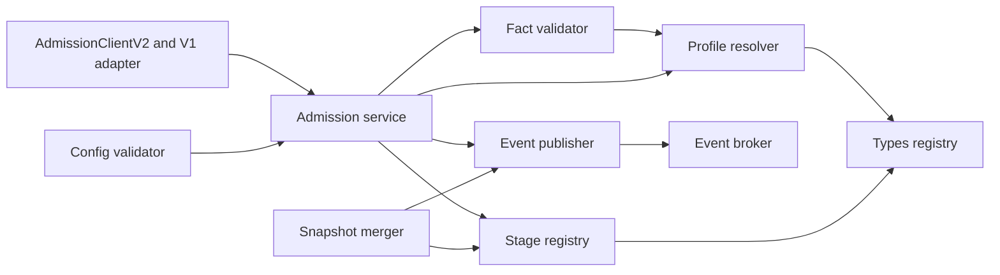
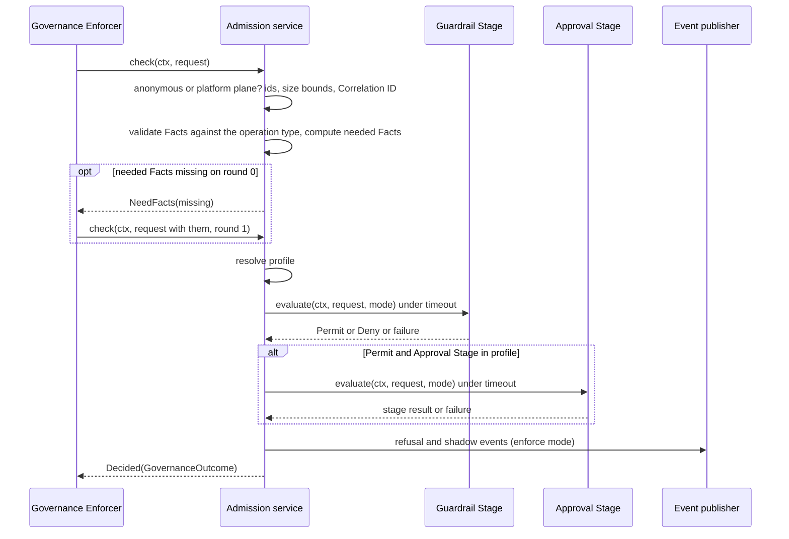

<!-- cpt:
version: 2.0.0
status: draft
module: admission-control
system: cf
-->

# Technical Design — Admission Control

<!-- toc -->

- [1. Architecture Overview](#1-architecture-overview)
  - [1.1 Architectural Vision](#11-architectural-vision)
  - [1.2 Architecture Drivers](#12-architecture-drivers)
  - [1.3 Architecture Layers](#13-architecture-layers)
- [2. Principles & Constraints](#2-principles--constraints)
  - [2.1 Design Principles](#21-design-principles)
  - [2.2 Constraints](#22-constraints)
- [3. Technical Architecture](#3-technical-architecture)
  - [3.1 Domain Model](#31-domain-model)
  - [3.2 Component Model](#32-component-model)
  - [3.3 API Contracts](#33-api-contracts)
  - [3.4 Internal Dependencies](#34-internal-dependencies)
  - [3.5 External Dependencies](#35-external-dependencies)
  - [3.6 Interactions & Sequences](#36-interactions--sequences)
  - [3.7 Database schemas & tables](#37-database-schemas--tables)
  - [3.8 Deployment Topology](#38-deployment-topology)
- [4. Additional context](#4-additional-context)
- [5. Traceability](#5-traceability)

<!-- /toc -->

- [ ] `p1` - **ID**: `cpt-cf-admission-control-design-admission-control`

## 1. Architecture Overview

### 1.1 Architectural Vision

Admission Control is the stateless governance gate of [Operation Governance](../../../../docs/arch/operation-governance/DESIGN.md). Each Consuming Gear's Governance Enforcer calls `AdmissionClientV2::check`. The gate validates the call and its Facts against the Governed Operation type, asks once for missing Facts, resolves the Governance Profile, and calls the applicable Governance Stages in order under timeouts: the Guardrail Stage (`policy-engine` by default), then the Approval Stage (`approval-service`). It stops at the first refusal and maps stage results to one Governance Outcome. Identity comes only from the `SecurityContext`, and anything that cannot be decided is refused. Refusals and shadow denials are published through a bounded queue that can never block or change an outcome. The gate also merges stage applicability into the Applicability Snapshot.

`AdmissionClientV1::admit` stays as a thin adapter: it runs the same pipeline with only the Guardrail Stage and maps the outcome to admitted or refused.

The gear has two crates: `admission-control-sdk` (contracts, models, GTS types, REST and gRPC projections, the Governance Enforcer, the `FactProvider` trait, and the conformance kit) and `admission-control` (the gate). The decision is recorded in [Operation Governance ADR 0001](../../../../docs/arch/operation-governance/ADR/0001-cpt-cf-operation-governance-adr-governance-gate.md).

### 1.2 Architecture Drivers

#### Functional Drivers

| Requirement | Design Response |
|---|---|
| `cpt-cf-admission-control-fr-admission-interface` | `AdmissionClientV2` with `check`, `check_batch`, `applicability`; `AdmissionClientV1` adapter (§3.3). |
| `cpt-cf-admission-control-fr-request-authenticity` | No subject fields; the gate reads `SecurityContext`, rejects anonymous and platform-plane calls. |
| `cpt-cf-admission-control-fr-identifier-validation` | GTS ID validation in the SDK, called first (§3.6). |
| `cpt-cf-admission-control-fr-request-bounds` | Fact count, byte-budgeted serialization, depth, and batch length checks. |
| `cpt-cf-admission-control-fr-governance-profile` | `cpt-cf-admission-control-component-profile-resolver` reads the Governed Operation type and Product configuration. |
| `cpt-cf-admission-control-fr-decision-order` | `cpt-cf-admission-control-seq-gate-operation`: request checks, profile, then ordered stages. |
| `cpt-cf-admission-control-fr-refusal-cause` | `OutcomeMapper` turns stage results into `GovernanceOutcome` (§3.1). |
| `cpt-cf-admission-control-fr-preview` | `Mode::Preview` passed to every stage; the event publisher is skipped. |
| `cpt-cf-admission-control-fr-correlation` | Caller's Correlation ID accepted, or minted. |
| `cpt-cf-admission-control-fr-missing-facts` | `cpt-cf-admission-control-component-fact-validator` validates Facts and returns `CheckResponse::NeedFacts` once. |
| `cpt-cf-admission-control-fr-engine-selection` | `cpt-cf-admission-control-component-stage-registry` resolves one instance per stage kind. |
| `cpt-cf-admission-control-fr-governed-operation-type` | GTS base type and traits in the SDK (§3.3). |
| `cpt-cf-admission-control-fr-enforcer` | `cpt-cf-admission-control-component-enforcer` in the SDK. |
| `cpt-cf-admission-control-fr-applicability` | `cpt-cf-admission-control-component-snapshot-merger`. |
| `cpt-cf-admission-control-fr-fail-closed` | Timeout around every stage call; no stage or any failure maps to `CouldNotRun`. |
| `cpt-cf-admission-control-fr-refusal-events` | `cpt-cf-admission-control-component-event-publisher`. |
| `cpt-cf-admission-control-fr-configuration-validation` | `cpt-cf-admission-control-component-config-validator`. |

#### NFR Allocation

| NFR ID | NFR Summary | Allocated To | Design Response |
|---|---|---|---|
| `cpt-cf-admission-control-nfr-fail-closed` | No Allowed on any failure | Admission service, stage registry | Every failure path yields a `CouldNotRun` refusal; the event path is off the decision path. |
| `cpt-cf-admission-control-nfr-overhead` | 5 ms p95 gate overhead | Admission service | Checks are in memory and bounded; declarations and profiles are cached by version. |
| `cpt-cf-admission-control-nfr-scale-out` | Linear scale-out | Whole gate | No state between checks; snapshot merging is recomputed from stage reports by version. |

### 1.3 Architecture Layers

- [ ] `p1` - **ID**: `cpt-cf-admission-control-tech-stack`

| Layer | Responsibility | Technology |
|---|---|---|
| Contract (SDK) | `AdmissionClientV2`, `GovernanceStagePluginClientV1`, `AdmissionClientV1`, models, errors, GTS types, projections | Rust, ToolKit contract binding, GTS |
| Enforcement (SDK) | Governance Enforcer, `FactProvider`, typed Fact API, conformance kit | Rust, `toolkit-policy-evaluation` (p2) |
| Domain | Check pipeline, outcome mapping, snapshot merging | Rust, `#[domain_model]` |
| Infrastructure | Stage resolution, event publisher, metrics | ClientHub, types-registry, event-broker, OTel |

## 2. Principles & Constraints

### 2.1 Design Principles

#### Decide Nothing That Can Be Delegated

- [ ] `p1` - **ID**: `cpt-cf-admission-control-principle-thin`

The gate orders stages and maps results. Every Policy decision, tenancy, and storage belong to the stages.

#### One Way to Refuse From a Failure

- [ ] `p1` - **ID**: `cpt-cf-admission-control-principle-single-refusal`

Every failure is a `CouldNotRun` refusal with a `FailureCondition`; there is no path from a failure to an Allowed outcome.

#### The Request Belongs to the Caller

- [ ] `p1` - **ID**: `cpt-cf-admission-control-principle-no-modification`

The gate never changes the request. A valid call returns only an outcome; an anonymous context or an invalid identifier returns an error instead.

### 2.2 Constraints

#### One Instance per Stage Kind, One Side-Effect Stage

- [ ] `p1` - **ID**: `cpt-cf-admission-control-constraint-single-engine`

At most one instance of each stage kind is resolved, and at most one stage with side effects is configured; it runs last.

#### Deployment Transparency

- [ ] `p2` - **ID**: `cpt-cf-admission-control-constraint-in-process`

The gate code is the same in every ToolKit profile. ClientHub returns the in-process implementation or a generated remote client; callers do not know which.

## 3. Technical Architecture

### 3.1 Domain Model

**Technology**: Rust types in `admission-control-sdk/src/models.rs`; domain structs use `#[domain_model]`.

- [ ] `p1` - **ID**: `cpt-cf-admission-control-entity-admission-request`
- [ ] `p1` - **ID**: `cpt-cf-admission-control-entity-verdict`
- [ ] `p1` - **ID**: `cpt-cf-admission-control-entity-engine-result`
- [ ] `p1` - **ID**: `cpt-cf-admission-control-entity-refusal-event`

| Entity | Description |
|---|---|
| GovernanceCheckRequest | `operation` (Governed Operation type ID), `resource { type, id?, tenant_id, version? }`, `facts` (JSON map keyed by Fact ID), `unavailable` (Fact ID → reason), `mode` (`Enforce` or `Preview`), `snapshot_version?`, `round` (0 or 1), `correlation_id?`. No subject fields; the subject comes from the `SecurityContext` and the calling gear from the service identity ToolKit attaches to the call. |
| CheckResponse | `Decided(GovernanceOutcome)` or `NeedFacts { missing, snapshot_version }`. `NeedFacts` is internal to the SDK; gears never see it. |
| GovernanceOutcome | `Allowed`, `Blocked`, `ApprovalRequired`, `ApprovalPending`, `Invalid`, `Unavailable { retryable }`, each with `refusal_reason?`, `cause?`, `produced_by` (stage, Policy and version, or Decisions), `obligations`, `correlation_id`. |
| Obligations | `approval_request?`, `unmet_requirements?`, `check_again_at?` (Approval Lease end). |
| StageResult | `Permit { shadow_denials }`, `Deny { reason_code, policies, shadow_denials }`, `ApprovalRequired`, `ApprovalPending { request, unmet }`, `Invalid`, (p3, external stages) `MissingFacts { names }`; failure is `StageFailure { condition, detail }`. |
| RefusalCause | `Policy { stage, reason_code, policies }`, `RequestTooLarge { bound }`, `InvalidRequest`, `CouldNotRun { condition }`. Only `CouldNotRun` is retryable, and not with `Internal`. |
| SizeBound | `FactCount`, `FactDepth` (fixed 64), `FactBytes`, `BatchLength`. |
| FailureCondition | `NoStage`, `StageUnavailable`, `StageTimeout`, `StageError`, `FactsMissing` (retryable only when the gear reported the Fact unavailable), `Internal` (a gate or gate–stage contract defect; not retryable). |
| ApplicabilitySnapshot | `version`, `signature`, entries per Governed Operation type and tenant scope: `governed`, `facts_read`, `stages`, (p2) `local_rules { source, reads, effect, profile_version }`. |
| AdmissionRequest, Verdict | V1 types: `enforcing_gear`, `action`, `resource_type`, `resource_id?`, `resource_tenant_id`, `properties`; `Admitted` or `Refused { cause }`. |
| RefusalEvent | Event payload (§3.3): one per (operation, Policy) pair; `enforced` false for shadow denials. |

Stage results map to outcomes as in the [Operation Governance DESIGN](../../../../docs/arch/operation-governance/DESIGN.md#31-domain-model). A stage result past the gate's bounds (more than 64 denials plus shadow denials, a reason code that is not 1–128 printable ASCII bytes, or a malformed Policy reference) is could-not-run `internal`.

### 3.2 Component Model

#### Admission Service

- [ ] `p1` - **ID**: `cpt-cf-admission-control-component-admission-service`

Owns the check pipeline (§3.6): context check, identifier validation, size bounds, Correlation ID, Fact validation, profile resolution, ordered stage calls under per-stage timeouts, outcome mapping, event emission (enforce mode only), and the outcome. Serves `check_batch` by running the pipeline per item in Preview mode with one profile resolution. Serves `AdmissionClientV1::admit` by running the pipeline with the Guardrail Stage only.

#### Profile Resolver

- [ ] `p1` - **ID**: `cpt-cf-admission-control-component-profile-resolver`

Reads Governed Operation types from Types Registry and the Product's Governance Profile configuration, and caches both by version.

#### Fact Validator

- [ ] `p1` - **ID**: `cpt-cf-admission-control-component-fact-validator`

Refuses a check whose calling gear identity is missing or does not own the Governed Operation type, and a provided Fact that is undeclared or does not match its property schema, as `Invalid`. Matches Policies by the type ID without its version, and passes that family to the stages as the action: a Fact renamed in the `replaces` trait is passed under both IDs, and an applicable Policy that reads a removed or retyped Fact gives `Unavailable`. Computes the needed Facts from the current merged snapshot: the `facts_read` of applicable entries, plus the Facts shown to Approvers when the Approval Stage may require approval. On round 0, missing Facts give `NeedFacts`; on round 1, or for a needed Fact in `unavailable`, the outcome is `Unavailable` with `CouldNotRun { condition: FactsMissing }`, counted per operation as a gear defect.

#### Governance Enforcer (SDK)

- [ ] `p1` - **ID**: `cpt-cf-admission-control-component-enforcer`

Runs in the Consuming Gear. Holds signed snapshot entries per tenant in an LRU cache, accepts only higher versions, and refreshes an entry on a change notice with a random delay. A missing entry, or one older than the Policy Propagation Delay, means a remote check. Translates read Fact IDs through `replaces` to the gear's current type version, calls the gear's `FactProvider` once per Fact Tier for the Facts that are read, calls `check`, answers one `NeedFacts`, maps the outcome to canonical errors, and parks work durably on Approval pending. Counts governed requests that completed without a check.

#### Stage Registry

- [ ] `p1` - **ID**: `cpt-cf-admission-control-component-stage-registry`

Resolves one instance per configured stage kind, like the platform's other plugin hosts: lists stage instances in Types Registry, applies the pinned `instance_id` or picks the vendor's lowest-priority instance, and takes its scoped client from ClientHub (in-process or generated remote client). A failure is not cached, so the next call retries. A call that arrives before a stage resolves refuses as `stage_unavailable` (retryable). The serve phase resolves every configured stage once eagerly, so an unresolvable configured stage fails startup.

#### Snapshot Merger

- [ ] `p1` - **ID**: `cpt-cf-admission-control-component-snapshot-merger`

On a stage change notice, or when its cached copy is older than the configured age, asks each stage for its applicability since its last version, merges the reports into one versioned Applicability Snapshot, signs it, and publishes a change notice with the tenant scope. It serves one tenant's entries on request. A stage that does not answer makes its scope count as governed. An operation whose resolved Governance Profile names a stage that is not deployed is marked governed for every tenant, and its check then gives `Unavailable` with `NoStage`.

#### Event Publisher

- [ ] `p1` - **ID**: `cpt-cf-admission-control-component-event-publisher`

A bounded in-memory queue (`event_queue_capacity`) and one background task publishing to `EventBrokerApi` under the gate identity. A full queue drops the event and increments the dropped-events metric; an absent, failing, or stalled broker, and every event still queued at shutdown, is logged, counted, and dropped the same way. Event types are registered at init, with background retries while the registry is unreachable.

#### Config Validator

- [ ] `p1` - **ID**: `cpt-cf-admission-control-component-config-validator`

Parses the strict configuration (unknown keys rejected), rejects zero for every numeric key, and rejects more than one stage with side effects. Any failure aborts init.

### 3.3 API Contracts

**Governance API** (`cpt-cf-admission-control-interface-governance-api`): `AdmissionClientV2` with `#[toolkit::rest_contract]` and `#[toolkit::grpc_contract]` projections under `/admission-control/v2`:

| Operation | REST | Description |
|---|---|---|
| `check(ctx, GovernanceCheckRequest) -> CheckResponse` | `POST /admission-control/v2/check` | One check, enforce or Preview |
| `check_batch(ctx, GovernanceBatchRequest) -> Vec<GovernanceOutcome>` | `POST /admission-control/v2/check-batch` | Preview of one operation on many resources |
| `applicability(ctx, tenant_id, since_version) -> ApplicabilitySnapshot` | `GET /admission-control/v2/applicability?tenant=&since=` | One tenant's snapshot changes since a version |

`Err` is only for an anonymous or platform-plane context (unauthenticated) or a malformed identifier (invalid argument, value never echoed). Everything decided or failed is an outcome. Projected onto canonical errors by the Governance Enforcer as in the [Operation Governance DESIGN](../../../../docs/arch/operation-governance/DESIGN.md#31-domain-model).

**Admission client** (`cpt-cf-admission-control-interface-admission-client`): `AdmissionClientV1::admit(ctx, &AdmissionRequest) -> Result<Verdict, AdmissionError>`, unchanged for callers. `enforcing_gear` and `action` must match `^[a-z0-9][a-z0-9._:-]{0,127}$`. Reason codes: `POLICY_REFUSED`, `REQUEST_TOO_LARGE`, `INVALID_REQUEST`, `COULD_NOT_RUN`.

**Stage plugin** (`cpt-cf-admission-control-interface-engine-plugin`): `GovernanceStagePluginClientV1::evaluate(ctx, &StageRequest) -> Result<StageResult, StageFailure>` and `applicability(ctx, since_version)`, scoped by the stage's GTS instance of `gts.cf.toolkit.plugins.plugin.v1~cf.core.admission_control.stage.v1~`. The instance properties declare `kind`, `order`, `side_effects`, and `preview`. Failure conditions map to could-not-run (`stage_unavailable`, `stage_timeout`, `stage_error`; retryable), invalid Facts (`Invalid`, not retryable), or contract violation (could-not-run `internal`, not retryable). Implementations must be cancel-safe: the gate drops the call when its timeout fires. `AdmissionEnginePluginClientV1` stays for the V1 adapter.

**GTS types** (`cpt-cf-admission-control-contract-gts`): the stage and engine plugin specs, the Governed Operation base type `gts.cf.core.admission_control.governed_operation.v1~` with its traits schema (per-Fact `tier`, `sensitive`, `approver_visible`, `binding`; `replaces` for renamed Facts), the error resource `gts.cf.core.admission_control.admission.v1~`, the refusal event type `gts.cf.core.events.event.v1~cf.core.admission_control.refusal.v1~`, and the snapshot change event type `gts.cf.core.events.event.v1~cf.core.admission_control.applicability_changed.v1~`, on topic `gts.cf.core.events.topic.v1~cf.core.admission_control.audit.v1`.

**Refusal event** (`cpt-cf-admission-control-contract-refusal-event`): the broker envelope carries the Correlation ID as `subject` (subject type `gts.cf.core.admission_control.admission.v1~`), the resource tenant as `tenant_id`, and the decision instant as `occurred_at`. The payload: `operation`, `resource_type`, `resource_id?`, `subject_id`, `subject_tenant_id`, `stage`, `enforced`, `cause`, `condition?`, `policy?`, `fact_names` (names only). Counts: a Policy denial with N Policies gives N events; too-large, invalid-request, and could-not-run give 1; each shadow denial gives 1 with `enforced: false`; Allowed, Approval pending, and Preview give none.

Configuration (`gears.admission-control.config`, unknown keys rejected): `stages { <kind>: { vendor, instance_id?, timeout_ms } }` (Guardrail Stage timeout 100 ms by default), `profiles` (Governance Profile per Governed Operation pattern), `max_facts` (256), `max_fact_bytes` (65536), `max_batch` (100), `snapshot_max_age_ms`, `event_queue_capacity` (1024). V1 `engine { vendor, instance_id? }` maps to the Guardrail Stage.

### 3.4 Internal Dependencies

| Dependency Module | Interface Used | Purpose |
|---|---|---|
| `types-registry` | `TypesRegistryClient` | Stage discovery, Governed Operation types, event registration |
| `event-broker` | `EventBrokerApi` (optional, via ClientHub) | Refusal events and snapshot change notices |
| Guardrail Stage | `GovernanceStagePluginClientV1` (scoped) | Guardrail Policies (`policy-engine` by default) |
| Approval Stage | `GovernanceStagePluginClientV1` (scoped) | Approvals (`approval-service`), optional |

### 3.5 External Dependencies

None. An external decision engine can be added as a stage.

### 3.6 Interactions & Sequences

#### Run a Governance Check

**ID**: `cpt-cf-admission-control-seq-gate-operation`

#### Refuse Because a Stage Could Not Answer

**ID**: `cpt-cf-admission-control-seq-engine-failure`

A stage in the profile that is absent, unavailable, failing, or timed out yields `Unavailable` with `CouldNotRun { condition }`; one event is emitted in enforce mode, and the failure is logged with the stage instance.

### 3.7 Database schemas & tables

- [ ] `p1` - **ID**: `cpt-cf-admission-control-db-none`

Not applicable: the gate is stateless and persists nothing.

### 3.8 Deployment Topology

- [ ] `p1` - **ID**: `cpt-cf-admission-control-topology-in-process`

Embedded profile: in-process with the Consuming Gears and the Guardrail Stage. Self-Hosted and Kubernetes Native profiles: a stateless, horizontally scaled unit with the Guardrail Stage linked in; the Approval Stage runs in its own unit and is reached through its remote client ([Operation Governance DESIGN §3.8](../../../../docs/arch/operation-governance/DESIGN.md#38-deployment-topology)).

## 4. Additional context

**Telemetry**: `admission_control_outcomes_total{outcome,cause}`, `admission_control_stage_call_seconds{stage}`, `admission_control_events_dropped_total`, and `admission_control_snapshot_version`. Labels come from closed sets. Log lines of a check run in an `admission` span carrying `correlation_id`, `operation`, and `resource_type`, all validated first.

**Identity and readiness**: events are published under the gate's fixed `GATE_SUBJECT_ID`, presenting the first-party wildcard token scope (`"*"`); what the gate may publish is decided by the RBAC grant of its subject. Stage calls carry the caller's `SecurityContext`. The gate is ready once serving, with every configured stage resolved.

**Security**: the request is untrusted input. Identifiers and Facts are validated against the Governed Operation type before use, and a rejected value is never echoed. Facts are asserted by the Consuming Gear; the gate checks their shape, not their truth. Events and spans carry Fact names, never values.

**Migration**: IRM keeps `AdmissionClientV1` until it adopts the Governance Enforcer; the adapter shares the pipeline, so V1 and V2 refuse the same way.

## 5. Traceability

- **PRD**: [PRD.md](./PRD.md)
- **Subsystem**: [Operation Governance DESIGN](../../../../docs/arch/operation-governance/DESIGN.md), [ADR 0001](../../../../docs/arch/operation-governance/ADR/0001-cpt-cf-operation-governance-adr-governance-gate.md), [ADR 0002](../../../../docs/arch/operation-governance/ADR/0002-cpt-cf-operation-governance-adr-fact-collection.md)
